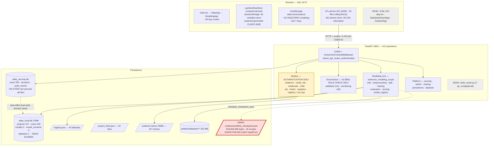
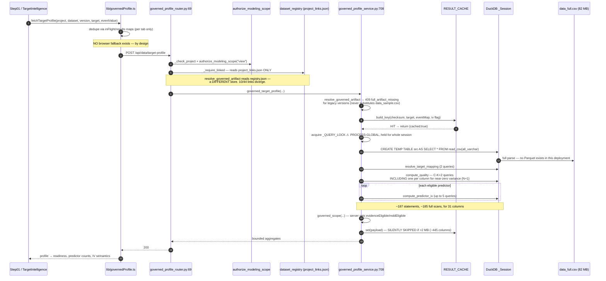
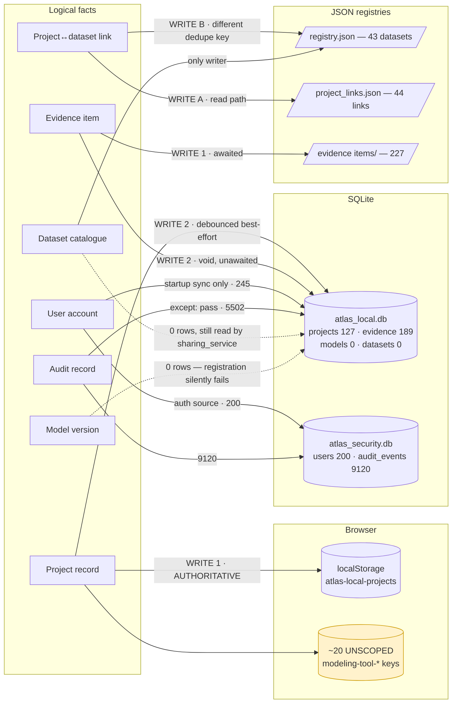

# 02 — System Architecture

**Method:** static inspection of all 224 backend Python modules and 286 frontend TypeScript files, AST-based import-cycle detection, live OpenAPI enumeration, and read-only database/filesystem inspection.

---

## 1. Scale and shape

| Metric | Value |
| --- | --- |
| Backend Python files / LOC | 224 / 44,770 |
| Frontend TS+TSX files / LOC | 286 / 97,237 |
| Routers registered in `server/main.py` | 39 |
| **HTTP operations (live OpenAPI enumeration)** | **415 across 370 paths** |
| Distinct persistent state stores | **11** |
| SQLite databases | 2 primary (`atlas_local.db` 27.3 MB, `atlas_security.db` 2.6 MB) **+ 36 stray per-process files** |
| Dead code (unregistered/unreachable) | ≈ 9,300 LOC |

The 415-operation count is measured from the running server's `/openapi.json`, not inferred. Largest surfaces: monitoring (40), admin (39), credit-risk (31), projects (27), analytics (27).

---

## 2. Frontend

**One live entry point, two dead ones.** `index.html` → `src/main.tsx` → `AtlasApp.tsx` (a 5-line passthrough) → `src/apps/ModelingApp.tsx` — the real shell with ~60 lazily-imported routes.

`src/App.tsx` (802 LOC) has **no importer**; it is the only consumer of `VITE_APP_TARGET` and the only reference to `StelaDashboardApp.tsx` (2,921 LOC). The guitarist stack (~4,900 LOC + a 1.87 MB PNG still emitted into `dist/`) is not a Vite build input. The multi-app mechanism is vestigial — every npm script hardcodes `--mode modeling`.

**Routing.** A single flat `<Routes>` block ([src/apps/ModelingApp.tsx:246-323](src/apps/ModelingApp.tsx#L246-L323)). Two structural observations:

- **The auth gate is a component-level branch, not a route guard** — a different `<Routes>` tree renders when `authUser === null`, and `me()` is re-fetched on **every** pathname change ([:96-111](src/apps/ModelingApp.tsx#L96-L111)).
- **No `projectId` appears in any URL** for the 14 workflow steps. Project scope is entirely ambient client state — the root cause of several cross-project findings in [07-frontend-ux-and-accessibility.md](audit-output/07-frontend-ux-and-accessibility.md).

**Two parallel step systems coexist** — declarative `WorkflowDefinition` records in `src/config/workflows.ts` (673 LOC) and a hardcoded legacy step map in `src/state/useWorkflowStore.ts:92-146`, with `mergeWorkflowStepsWithDefinition` existing purely to reconcile them. This is the signature of an incomplete migration, and it is where the new-project completion-mark leak originates.

**There is no single API client.** 53 files call `fetch()` directly; `VITE_API_BASE` is re-derived **37 times** with three different fallbacks — including two pointing at **`http://localhost:8000`**, the wrong port with no `/api` segment ([src/components/CorrelationHeatmap.tsx:9](src/components/CorrelationHeatmap.tsx#L9), [src/components/PairwiseScatterMatrix.tsx:9](src/components/PairwiseScatterMatrix.tsx#L9) — verified). `src/lib/api.ts` omits `credentials: "include"` and is imported by zero call sites for its fetch helpers — a latent 401 trap.

---

## 3. Backend layering — three mutually inconsistent styles

| Style | Pattern | Routers |
| --- | --- | --- |
| **A** | Router → Service → Repository → SQLite | persistence, monitoring, validation, model_registry, registry, scoring_runs |
| **B** | Router → module-level JSON store (**no service layer**) | datasets, evidence, projects, charts, model_diagnostics, notebooks, sql_studio, credit_risk, model_documentation, analytics |
| **C** | Router → process-global in-memory proxy | `DATASTORE`, `RESULTS`, `TRAINING_JOBS`, `EVAL`, `TRAINER` |

Style B has no repository abstraction at all. `server/datasets/dataset_registry.py` (920 LOC) simultaneously performs file I/O, authorization, profiling, **and raises `HTTPException`** — a storage module that imports FastAPI cannot be reused outside HTTP. This layering inconsistency maps almost exactly onto the authorization gap in [03-security-and-isolation.md](audit-output/03-security-and-isolation.md): **Style A routers have resource authorization; Style B routers largely do not.**

**Three incompatible authorization models coexist:** per-project ACL via `authorize_modeling_scope` (the modeling core); global role checks that never consult project membership (validation, monitoring — 54 endpoints); and authentication-only (~111 endpoints across 12 routers).

**A genuine strength:** `assert_api_routes_authenticated` ([server/main.py:82-103](server/main.py#L82-L103)) walks every route's dependency tree at startup and raises if `require_user` is absent. It should be preserved and extended to authorization.

---

## 4. State stores — the complete inventory

| # | Store | Holds | Authoritative? | Survives restart? |
| --- | --- | --- | --- | --- |
| 1 | `atlas_local.db` (27.3 MB, 60 tables) | projects 127 · users 245 · audit_log · evidence_artifacts 189 · workflow_state | Yes for projects/ACL | Yes |
| 2 | `atlas_security.db` (2.6 MB) | users 200 · credentials · sessions · audit_events · project_access | Yes for auth | Yes |
| 3 | `registry.json` (88.5 KB) | 43 datasets + ACL + linkedProjects | **Yes — the real Dataset Library** | Yes |
| 4 | `project_links.json` | 44 project↔dataset links | **Yes — the `_require_linked` read path** | Yes |
| 5 | `artifacts/datasets/**` (332 MB) | `data_full.csv` per version | **Yes — governed population** | Yes |
| 6 | Evidence JSON (`items/*.json`, 44 MB, 203 files) | 227 registry entries, 112 projects | **Yes — what the Evidence Graph reads** | Yes |
| 7 | Other JSON registries (credit_risk, notebooks, MDD, scoring_runs) | domain artifacts | Yes | Yes |
| 8 | `DATASTORE` — `_DATASTORES[(user_id, project_id)]` | raw/processed frames, splits, meta | Yes for the live draft | Only via #9 |
| 9 | `.runtime/workflow_checkpoint.json` — **923,653,366 bytes** | full multi-scope snapshot of #8/#10 | Recovery snapshot | **Currently failing — see §6** |
| 10 | `RESULTS` — `_RESULT_STORES[(user, project)]` | training summary, model artifacts, final model | Yes for `/train/last` | Partially (fitted models never survive) |
| 11 | `TRAINING_JOBS` | live job orchestration | Yes while running | **No, by explicit design** |
| — | Browser `sessionStorage` / `localStorage` | workflow progress, project registry, ~20 unscoped keys | **Yes for workflow progress** | Per-browser only |

**36 stray SQLite files** named `atlas_api_context_<pid>_<port>_security.db` sit in `server/data/` — verified. Each API process appears to create its own security database. This is a hygiene and correctness concern flagged in [05-persistence-jobs-and-recovery.md](audit-output/05-persistence-jobs-and-recovery.md).

---

## 5. Sources of truth — nine duplicated facts, with **measured** divergence

This is the priority output of this lane. Divergence is measured, not hypothesised.

| Fact | Store A | Store B | Measured divergence |
| --- | --- | --- | --- |
| **Project↔dataset link** | `project_links.json` (read path) | `registry.json → linkedProjects[]` (same function, different dedupe key) | **10 of 44 pairs exist only in A** |
| **Evidence item** | `evidence_registry.json` + `items/` (227) | SQLite `evidence_artifacts` (189) | 38-record gap; **within A: 53 registry entries with no item file, 29 item files not in the registry** |
| **User account** | `atlas_security.db.users` (200) | `atlas_local.db.users` (**245**) | 45-row gap; one-way startup-only sync |
| **Audit record** | `audit_events` (9,120) | `audit_log` (5,502) | 3,618-event gap; second write wrapped in `except: pass` |
| **Project record** | `localStorage` (**written first, authoritatively**) | SQLite `projects` (debounced best-effort mirror) | 127 SQLite rows vs 36 linked projects vs 112 evidence projects |
| **Project ACL** | `resource_permissions` (176) — the authorization path | `project_access` (27) — consulted by nothing | second table is dead |
| **Dataset catalogue** | `registry.json` (43 datasets) | SQLite `datasets` / `dataset_versions` (**0 / 0 rows**) | table B has **no writer**; `sharing_service.py:106` reads it and always gets `None` |
| **Modeling population** | `data_full.csv` | `DATASTORE.raw_df` + checkpoint + sessionStorage preview | same CSV materialized up to 4× |
| **Target / selected columns** | server `DATASTORE` | browser `sessionStorage` | `activate_dataset_version` nulls the target server-side while the client independently guesses one |

**The most consequential:** the browser is the source of truth for project identity, but `authorize_modeling_scope` raises **404** if the SQLite row is absent. A failed debounced mirror produces a fully functional local project whose every backend call 404s — and the failure is asynchronous and invisible at creation time.

---

## 6. The checkpoint — a live, observable runtime failure

**VERIFIED IN LOGS by the main agent.** `uvicorn.err.log` records, in a single session:

```
147: Workflow checkpoint is critically large: 236674128 bytes (critical threshold 104857600)
234: Failed to save workflow checkpoint: TypeError('Object of type int64 is not JSON serializable')
235: ... 400499872 bytes
322: Failed to save workflow checkpoint: TypeError(...)
323: ... 564325616 bytes
410: Failed to save workflow checkpoint: TypeError(...)
411: ... 728151360 bytes
498: Failed to save workflow checkpoint: TypeError(...)
499: ... 891977104 bytes
```

Deltas are **exactly +163,825,744 bytes** each time — one additional `(user, project)` scope holding the same raw frame. The file on disk is **923,653,366 bytes**, verified — **8.8× over its own "critical" threshold**, which the code documents as log-only ("Thresholds NEVER discard state").

`json.dumps(payload, indent=2, sort_keys=True)` at [server/core/session_checkpoint.py:486](server/core/session_checkpoint.py#L486) has **no `default=` handler** — verified — and `target` / `training_timestamp` are inserted raw, bypassing `_encode()`. A single numpy scalar aborts the write for **all 32 scopes at once**, and the process continues as though persistence works.

**This is the clearest single defect in the audit: the recovery mechanism is simultaneously non-functional, unbounded, and a startup latency bomb.**

---

## 7. Architectural debt

**Dead code (~9,300 LOC):** `server/stela_router.py` (573 LOC, 7 endpoints, **0 references in `main.py`** — verified), `src/App.tsx`, `src/apps/StelaDashboardApp.tsx`, the guitarist stack, and the 0-row SQLite dataset schema with no writer.

**God modules.** Backend: `eval_service.py` 2,613 · `trainer.py` 1,451 · `workspace_service.py` 1,072 · `registry_service.py` 1,071 · `python_execution.py` 1,054 (router + sandbox at package root) · `security_store.py` 959 (**fan-in 45**) · `dataset_registry.py` 920 (**fan-in 24**).

Frontend: **`WorkflowPlaceholderStep.tsx` — 11,768 lines, verified.** 137 React components in one file with a single default export, behind one route, producing a 921 KB bundle chunk. It is 12% of the frontend and the single largest obstacle to safe change. Then `CreditRiskStudio.tsx` 3,836 · `Step01_DataAcquisition.tsx` 3,035 (54 `useState`).

**Two real import cycles**, both through `dataset_registry`, broken only by a function-body lazy import. Four other modules use the same workaround. This is *why* `dataset_registry` became a 920-LOC god module.

**Concurrency:** `registry.json`, `project_links.json`, and `evidence_registry.json` are all updated by read-whole-file → mutate → write-whole-file **with no lock**. The write is atomic (temp+rename); the read-modify-write is not. Two concurrent registrations lose one — consistent with the 29 orphan evidence files observed.

---

## 8. Diagrams

### 8.1 Component map



### 8.2 Governed profiling request flow



### 8.3 Source-of-truth map



---

## 9. Architectural verdict

**The direction is sound.** The durable-lifecycle thesis, the governed-scope contract, the server-derived analytical plane, the startup authentication assertion, and the scoring-run flow (the best-layered path in the codebase — single service entry, re-authorization, idempotency, explicit synchronous disclosure) are all correct enterprise instincts.

**The debt is concentrated and nameable**, not diffuse:

1. **Two persistence philosophies were never reconciled.** The SQLite repository layer is the intended design; the JSON registries are the working system. Nine facts live in both. This is the root of most P1s in this audit.
2. **The frontend owns identity the backend requires.** Client-generated project ids plus best-effort mirroring plus a 404-on-missing guard is a fragile contract.
3. **Later routers skipped the layering *and* the authorization** that the modeling core established.
4. **The recovery mechanism is broken and unbounded**, and its own guard rails are documented as advisory.

None of this argues for a rebuild. Every fix named above is a consolidation of components that already exist and already work somewhere in this codebase.
