# 06 — Model Lifecycle, Reproducibility, Evidence, MDD, Validation, Monitoring

**Method:** static review of the registry, training, scoring, evidence, documentation, validation and monitoring modules and all migrations, plus **independent read-only verification against the live SQLite database** (`mode=ro` URI, SELECT/PRAGMA only). Every row count below was re-run by the main agent and matched the lane's report exactly.

---

## 1. Headline judgement

The architectural instincts here are strong. `analysis_scope.py`, the `mdd_*` normalized schema, `documentation_bundle`, the validation challenge/response/finding/approval model, and the monitoring entity model are all **correctly designed**. The consistent failure mode is that the correct design is built and then **not wired into the path users actually take**.

The governed lineage spine — the thing that makes ATLAS a model-risk platform rather than a notebook — is **code that has never executed in this environment**.

---

## 2. Verified database state (read-only query, this audit)

| Table | Rows |
| --- | --- |
| `projects` | **127** |
| `users` | 245 |
| `resource_permissions` | 176 |
| `scoring_runs` | **15** |
| `evidence_artifacts` | 189 |
| **`models`** | **0** |
| **`model_versions`** | **0** |
| `datasets` | **0** |
| `dataset_versions` | **0** |
| `documentation_packages` | 0 |
| `mdd_documents` / `mdd_content_blocks` | 0 / 0 |
| `validation_cases` / `validation_approvals` | 0 / 0 |
| `monitoring_plans` / `monitoring_baselines` / `monitoring_runs` | 0 / 0 / 0 |

**Lineage completeness on the 15 scoring runs that DO exist:**

```
NULL model_version_id:     15/15
NULL dataset_version_id:   15/15
NULL feature_manifest_version: 15/15
model_version = '2026-07-24T14:35:23.224732'   ← a naive local-time timestamp string
project_id = NULL on 12/15                     ← ON DELETE SET NULL fired; orphaned
```

**Evidence integrity:** `artifact_hash` is NULL or empty on **186 of 189** rows.

> `model_registry_service.py:104` states callers reference the durable model/version pair and "never a timestamp string." Every live scoring run uses a timestamp string. **OBSERVED FACT**, not inference.

**Why:** `_register_model_version` swallows every exception and returns `None` ([server/evaluation/eval_router.py:277-278](server/evaluation/eval_router.py#L277-L278)). Registration failure is silent and indistinguishable from "Save Final Model" succeeding. And `dataset_version_id` is **hardcoded**:

```python
# server/evaluation/eval_router.py:271
dataset_version_id=None,  # no registered Dataset Library version necessarily exists
```

**INFERENCE:** either the registration path has never been exercised, or it fails silently every time. Either way the durable lineage exists only as unexercised code.

Note also the **dual-store divergence**: SQLite `datasets`/`dataset_versions` are empty while the JSON Dataset Library holds 12 datasets (verified live via `GET /api/datasets`). The two stores do not reconcile.

---

## 3. Lineage map — hop by hop

| Hop | Durable link? | Evidence |
| --- | --- | --- |
| Project → Dataset (Library) | JSON only, not SQL | `dataset_registry.py:657` writes `artifacts/datasets/links.json` |
| Dataset → Dataset Version (SQL) | FK exists, but **content-mutable** | `dataset_repository.py:46-73` — `ON CONFLICT DO UPDATE SET dataset_hash = excluded.dataset_hash` |
| Dataset Version → **Feature Manifest** | **NO PERSISTED LINK** | `feature_service.py:187-204` writes only `DATASTORE.meta`; no `feature_manifests` table exists |
| Feature Manifest → Split | **in-memory only** | `split_router.py:179-210`; no `splits` table |
| Split → Training Job | **in-memory only** | `training_job_service.py:82` — `self._jobs: dict`; no `training_jobs` table |
| Training Job → Model Version | column exists, never FK, never populated | `0013_model_registry.sql:33` `training_run_id TEXT` (no REFERENCES) |
| Dataset Version → Model Version | **hardcoded NULL** | `eval_router.py:271` |
| Model → Model Version | FK, INSERT-only | `model_registry_repository.py:128-160` — sound design, 0 rows |
| Model Version → Scoring Run | column exists, **NULL 15/15** | `0013_model_registry.sql:69` |
| Scoring Run → Scored Dataset | content is **client-supplied** | `scoring_router.py:70` — `df = pd.DataFrame(payload.rows)`, not the governed parquet |
| Evidence → Documentation | **NO LINK** | MDD artifact contains 0 `evidenceId` |
| Documentation → Validation | **NO LINK** | `0005_validation_center.sql:1-22` — no `mdd_document_id`, no `model_version_id` |
| Approval → Model Version | **NO LINK** | `validation_approvals` has no model column |
| Model Version → Monitoring | **NO LINK** | `monitoring_plans` keyed on `project_id` only |

**Tables that do not exist anywhere:** `training_jobs`, `feature_manifests`, `splits`, `model_approvals`, `vendor_models`.

```mermaid
graph LR
  classDef ok fill:#0f5132,stroke:#0a3622,color:#fff
  classDef weak fill:#664d03,stroke:#997404,color:#fff,stroke-dasharray:4 3
  classDef broken fill:#58151c,stroke:#842029,color:#fff,stroke-width:3px
  classDef ephemeral fill:#212529,stroke:#495057,color:#adb5bd,stroke-dasharray:2 4
  classDef dead fill:#41464b,stroke:#6c757d,color:#ced4da,stroke-dasharray:8 4

  PROJ["Project<br/>127 rows"]:::ok
  DV["Dataset Version<br/>JSON: 12 · SQL: 0<br/>hash never verified"]:::weak
  FM["Feature Manifest<br/>DATASTORE.meta only<br/>NO TABLE"]:::ephemeral
  SP["Split<br/>config hash, no indices<br/>NO TABLE"]:::ephemeral
  TJ["Training Job<br/>in-memory dict<br/>NO TABLE"]:::ephemeral
  MV["ModelVersion<br/>0 ROWS LIVE"]:::broken
  ART["model.joblib<br/>sha256 stored, never verified"]:::broken
  SR["ScoringRun · 15 rows<br/>model_version_id NULL 15/15<br/>dataset_version_id NULL 15/15"]:::broken
  EV["Evidence · JSON 203 / SQL 189<br/>two disconnected stores<br/>modelVersionId 0/203"]:::broken
  MDD["MDD · 3 parallel paths<br/>JSON 2 docs · SQL 0 · mdd_* 0"]:::broken
  BUNDLE["documentation-bundle API<br/>the ONE real projection<br/>FRONTEND NEVER CALLS IT"]:::dead
  VAL["ValidationCase / Approval<br/>project_id only<br/>NO model_version_id"]:::broken
  MON["Monitoring Plan / Baseline<br/>NO model_version_id<br/>values typed by hand"]:::broken

  PROJ --> DV
  DV -. "no persisted link" .-> FM
  FM --> SP --> TJ
  TJ -. "swallows all exceptions<br/>eval_router.py:277" .-> MV
  DV -. "dataset_version_id=None<br/>HARDCODED :271" .-> MV
  MV --> ART
  MV -. "NULL 15/15" .-> SR
  SR --> EV
  EV -. "NO LINK" .-> MDD
  MV -. dead code .-> BUNDLE
  BUNDLE -. never invoked .-> MDD
  MDD -. "NO LINK" .-> VAL
  VAL -. "NO model binding" .-> MV
  MON -. "NO model binding" .-> MV
```



---

## 4. Integrity: checksums computed, stored, never verified

| Artifact | Hash computed | Stored | **Verified on read?** |
| --- | --- | --- | --- |
| Model joblib | `model_artifacts.py:60` | `model_versions.checksum` | **NO** |
| Scoring parquet | `scoring_run_artifacts.py:62` | `scoring_runs.checksum` | **NO** |
| Dataset version | `dataset_registry.py:318,402,489` | `versions[].hash` | **NO** |

`load_model_artifact` ([model_artifacts.py:77-83](server/model_registry/model_artifacts.py#L77-L83)) checks path containment and existence, then calls `joblib.load(path)` — pickle, which **executes on deserialization** — with no checksum comparison. Nothing prevents an artifact being swapped on disk without detection. There is no integrity-scan endpoint and no re-hash on read.

Compounding: `write_model_artifact` has no `exists()` guard despite the "written once, never mutated" docstring at [model_artifacts.py:14-15](server/model_registry/model_artifacts.py#L14-L15); and `scoring_run_repository.py:83-107` upserts **every** column on conflict — including `checksum`, `metrics_json` and `model_version_id` — contradicting the "immutable once created" claim at [scoring_run_artifacts.py:7-8](server/scoring_runs/scoring_run_artifacts.py#L7-L8).

---

## 5. Reproducibility — what is and is not captured

| Element | Captured? | Evidence |
| --- | --- | --- |
| **Random seed** | **Recorded but IGNORED** | `training_job_service.py:194` records `request.random_seed`; `train_models()` ([trainer.py:1268-1279](server/training/trainer.py#L1268-L1279)) has **no seed parameter**; 29 sites hardcode `random_state=42`. A user setting seed 7 gets a record saying 7 and a model trained at 42. |
| Hyperparameters | Partial — only when grid search ran | `eval_router.py:259` |
| Feature order | Not copied into `model_versions` | `training_job_service.py:546-551` |
| Preprocessing pipeline | Implicitly, inside the pickle | `trainer.py:995-1000` |
| **Target class mapping** | **NO** | `trainer.py:980-993` — `LabelEncoder` is a local; `classes_` never persisted. Also fit on `concat([y_train, y_test])`, so class ordering depends on both splits. |
| Split identity | Config hash only — **no row indices** | `split_router.py:183` |
| Library / Python versions | **NO** | `environment_inventory.py:76-130` computes exactly this and is called **only** from the Python code panel |
| `algorithm_version` | **Misnamed** — holds a class name | `eval_router.py:257` |
| Code identity / commit SHA | **NO** | absent |

**Can the model be rebuilt from the stored record alone? No.** Missing: the training data (`dataset_version_id` is None), the split (indices never stored), the feature manifest (no table), the target encoding, the environment, default hyperparameters, and code identity. You can load the pickle and re-score — that is **artifact reuse, not reproducibility**. A validator cannot independently rebuild the model, which is the SR 11-7 expectation.

**Serialization:** joblib exclusively, with **no version-compatibility handling** — no `sklearn.__version__` recorded, no check at read, no exception handling around `joblib.load`. A scikit-learn bump produces `InconsistentVersionWarning` (not an error) and unpickles anyway. Note the irony at [eval_router.py:330-334](server/evaluation/eval_router.py#L330-L334): model export is **refused** citing the need for a "signed model registry or approved ONNX/skops pipeline" — deferring to a registry that stores an unsigned, unverified pickle.

---

## 6. Evidence: two stores, mutable, unattributed

**Two independent, non-communicating evidence systems:** the JSON store (`evidence_store.py`, 203 items, read by the Evidence Graph UI) and the SQL store (`evidence_repository.py`, 189 rows, written by scoring runs and monitoring). **They never see each other** — `evidence_store.graph()` builds nodes exclusively from the JSON registry.

Identity carried by the 203 live JSON items:

| Field | Coverage |
| --- | --- |
| `projectId` | 203/203 (present, **not authorized**) |
| `datasetVersionIds` non-empty | **1/203** |
| **`modelVersionId` anywhere** | **0/203** |
| `createdBy == "ATLAS"` (no human) | **184/203** |
| `analysisScope` present | **18/203** |

**Evidence is neither immutable nor append-only:**
- **Silent overwrite by design** — `evidence_id_for()` derives the id from `(projectId, evidenceType, sourcePage, artifactType, artifactId, title)` ([evidence_store.py:62-69](server/evidence/evidence_store.py#L62-L69)); re-running the same analysis rewrites the file with no history and no supersession chain.
- **Editable** — `PUT /api/evidence/{id}` merges an arbitrary dict, including `createdAt` and `createdBy`.
- **Hard-deletable** — `path.unlink()`, no tombstone, **no audit event** (grep for `audit_event` in `server/evidence/` returns nothing).
- **No project authorization** — confirmed live in [03-security-and-isolation.md](audit-output/03-security-and-isolation.md).

### The `governed_version` / `workspace_draft` contract is enforced at exactly one endpoint

`server/analytics/analysis_scope.py` is a genuinely well-built module: scope derived from server state, `evidenceEligible`/`mddEligible` as outputs never inputs, scope identity in cache keys. `require_evidence_eligible()` ([:300-326](server/analytics/analysis_scope.py#L300-L326)) is the gate.

**Its only call site in the entire codebase is [server/analytics/target_intelligence_router.py:284](server/analytics/target_intelligence_router.py#L284).**

`POST /api/evidence` → `upsert_evidence()` → `normalize_item()` validates only enum membership; it never inspects `analysisScope`, never calls `is_governed`, never calls `require_evidence_eligible`. Worse, it **auto-promotes** an item to `status="ready"` when `qualityScore >= 85` ([evidence_store.py:131-134](server/evidence/evidence_store.py#L131-L134)) — and `qualityScore` merely counts the presence of client-supplied fields.

**Therefore workspace-draft results CAN become governed evidence** on every path except Target Intelligence. Empirically, 185 of 203 live items carry no scope at all — the contract governs ~9% of evidence in practice. The module's own preamble describes precisely the defect that remains open elsewhere.

---

## 7. MDD — three parallel paths; the real projection is dead code

| Path | Storage | Live | Used by |
| --- | --- | --- | --- |
| **A** | flat JSON, `artifacts/model_documentation/*.json` | **2 documents** | the live Studio UI |
| **B** | `documentation_packages` table | **0 rows** | **the Registry dashboard reads this** for documentation readiness |
| **C** | `mdd_*` — 12 normalized tables | **0 rows, 0 readers, 0 writers** | nothing |

Path **C** is the *correct* design — `mdd_content_blocks.source_type` + `source_reference_json` + `generated_indicator`, `mdd_evidence_links.canonical_version_reference`, `mdd_change_records` with prior/new text hashes. It was designed and never wired up. Meanwhile the Registry reports documentation status from path **B**, which has zero rows, while users edit path **A**.

**A real MDD artifact on disk (26 sections) contains zero occurrences of** `modelVersionId`, `modelId`, `datasetVersionId`, `scoringRunId`, `evidenceId`, `checksum`, `validationId`, or `monitoringPlanId`.

The champion model — the single most consequential fact in an MDD — is derived by substring-matching a JSON dump:

```python
# server/model_documentation/documentation_store.py:273-281
text = json.dumps(project).lower()
if "random forest" in text: return "Random Forest"
if "linear regression" in text: return "Linear Regression"
return "Not selected"
```

`contextSummary` is a **frozen snapshot** taken at creation ([:313](server/model_documentation/documentation_store.py#L313)) and never refreshed. `attach_evidence` accepts an arbitrary dict with no `evidenceId` and no existence check. `sectionChangeRecords` uses `str(hash(prior_text))` — Python's **per-process-salted** `hash()`, so the same text yields a different value after every restart, making the version-control summary non-reproducible.

**The frontend is literally a copy-paste editor.** [src/steps/ModelDocumentationStudio.tsx:686-688](src/steps/ModelDocumentationStudio.tsx#L686-L688) is a `<textarea>` bound to `section.userNarrative`; [:666](src/steps/ModelDocumentationStudio.tsx#L666) is a button whose entire behaviour is to paste the frozen `autoDraft` boilerplate into that field.

**The one correct governed projection exists and is unused.** `GET /model-versions/{id}/documentation-bundle` ([model_registry_router.py:83-122](server/model_registry/model_registry_router.py#L83-L122)) correctly joins model version + hyperparameters + metrics + scoring runs + evidence for one immutable version. Its frontend client `getDocumentationBundle` ([src/model-registry/modelRegistryClient.ts:127-129](src/model-registry/modelRegistryClient.ts#L127-L129)) is exported and **never called**.

**Honest assessment: MDD is roughly 10% of the way to a governed projection.** The template structure and section/status vocabulary are validator-aligned and correct. The remaining ~90% is prose templates, a frozen snapshot, a substring-guessed champion, identity-free attachments, salted-hash change records, and a textarea — i.e. exactly the copy-and-paste MDD the product thesis says must not exist.

---

## 8. Validation independence — bypassable in one HTTP call

**The control that exists is real.** `approve()` ([validation_service.py:360-380](server/validation/validation_service.py#L360-L380)) rejects an approver equal to the submitter, with an audit event, regardless of role.

**Three defects defeat it:**

1. **Total bypass via PATCH.** `update_case()` ([:181-197](server/validation/validation_service.py#L181-L197)) merges the payload with no transition allow-list, and `CaseUpdateRequest` exposes `status` and `final_disposition`. So `PATCH /api/validation/cases/{id} {"status":"approved","final_disposition":"approved"}` reaches "Approved by validation" — which is what the Registry surfaces — **without ever calling `approve()`**. No approval row, no rationale, no self-approval check, no audit event.

2. **It compares against the submitter, not the developer.** `submitted_by` is whoever clicked Submit. The person who *built* the model (`models.owner_user_id` / `model_versions.created_by`) is **never consulted** — grep for `owner_user_id` in `server/validation/` returns nothing. A developer can approve their own model by having a colleague submit the case. Role sets overlap: `OWNER_ROLES ∩ VALIDATOR_ROLES = {admin, model_manager, manager, validator}`.

3. **Approvals name no model.** `validation_cases` and `validation_approvals` have no `model_version_id`. An approval says "project P was approved on date D by user U" — not which model, version, data, or document. The project can be retrained without limit and the approval persists, unqualified.

Separately, `POST /api/model-versions/{id}/governance-status` requires only **`"view"`** permission ([model_registry_service.py:187,265](server/model_registry/model_registry_service.py#L187)), so any user with read access can set `approvalStatus: "approved"` with no rationale and no audit event. And `server/validation/router.py` contains **no `authorize_modeling_scope` at all**.

**What is modeled correctly:** `validation_challenges`, `validation_responses`, `validation_findings` (with severity, remediation owner, due date, management-response flag), `validation_approvals` (with `conditions_json`), `validation_checklist_items` with a uniqueness constraint, and an append-only `validation_case_events` log. All three dispositions — approved / approved-with-conditions / rejected — are handled. **This is the strongest schema in the lifecycle domain.**

---

## 9. Monitoring — complete entity model, unbound and unorchestrated

The eight-entity schema (plan, metric with upper/lower warning and breach thresholds, run, observation, alert, corrective action, baseline, event log) is **complete and correct**, and there is a real monitoring→validation escalation path (`create_validation_finding`, role-gated).

But:

- **No model binding.** `monitoring_plans` and `monitoring_baselines` carry `project_id` only — no `model_version_id`. **Monitoring cannot detect that the model it monitors has been replaced, because it never knew which model it was monitoring.**
- **Observations are typed in by hand.** `record_observation` ([monitoring_service.py:310-334](server/monitoring/monitoring_service.py#L310-L334)) reads `observed_value` straight from the request body, performs **no role check**, and never reads `scoring_runs.psi_json`/`vsi_json` — **which are populated** ([scoring_run_service.py:144-145](server/scoring_runs/scoring_run_service.py#L144-L145)). ATLAS computes the drift statistics and then asks the user to type a number.
- **No orchestration.** No scheduler, cron, or background task anywhere in `server/monitoring/`. `next_monitoring_date` is a stored string nothing reads. `summary()` counts `next_reviews_due` as *any plan with a date set* — a plan overdue by a year is indistinguishable from one due tomorrow.
- **No project authorization** (confirmed live: a non-owner receives 200 on foreign monitoring plans).

---

## 10. Stale state and invalidation — **absent**

**There is no content-driven invalidation mechanism for documentation, validation, monitoring, or evidence.** Reported as an absence, verified by grep.

What exists: in-memory split staleness on dataset/manifest/target change ([split_router.py:77-100](server/splitting/split_router.py#L77-L100)) — a good, correct mechanism, scoped to one session; an in-memory analytics cache invalidation; a manually settable evidence `"stale"` string; and a 90-day wall-clock project timer.

What does not exist: nothing marks an MDD stale when its frozen snapshot diverges; nothing marks a validation case stale when a new model version registers (the table has no model reference to compare against); nothing marks a monitoring baseline stale when the champion changes; nothing marks evidence stale when its source version changes (evidence carries no version identity to invalidate against). `archive_version()` clears `models.current_version_id` and touches nothing downstream — the code says so explicitly: *"Scoring Runs, Evidence, and Dataset Versions referencing an archived model/version are untouched"* ([model_registry_service.py:279-282](server/model_registry/model_registry_service.py#L279-L282)).

**Consequence:** a dataset can be re-versioned, a model retrained, or a champion swapped, and the MDD, the validation approval, and the monitoring plan all continue to display as current with no signal of any kind. **This is the single largest model-risk gap in the platform.** SR 11-7 requires that material change trigger re-review; ATLAS cannot detect material change, therefore cannot trigger re-review, therefore cannot demonstrate the ongoing validity of any approval.

---

## 11. Vendor / externally developed models — **no path exists**

Grep across `server/**/*.py` for `vendor|third_party|external_model|externally developed` returns **zero matches**. `create_model_version` requires a live in-process `fitted_object` and is only ever called from ATLAS's own trainer. There is no model-artifact upload endpoint. `models` has no `development_source` or vendor columns. `mdd_framework.FAMILY_REQUIREMENTS` has 12 families, none for vendor models.

A regulated institution cannot register, validate, document, or monitor a purchased scorecard, a bureau score, or a vendor AML engine in ATLAS at all. SR 11-7 §VI explicitly requires vendor models to be in the inventory and validated to the same standard.

---

## 12. Aspiration versus reality

| Claim (in code or docs) | Reality |
| --- | --- |
| "MDD is a governed projection of lifecycle evidence" | A `<textarea>` plus a button that pastes boilerplate. The real projection API is dead code. |
| "No copy-and-paste MDD" | `ModelDocumentationStudio.tsx:666` is a button whose sole function is to paste generated boilerplate into the editable field. |
| "A ModelVersion is immutable once created" | True at the repository layer. Irrelevant: **0 rows exist**. |
| "never a timestamp string" (`model_registry_service.py:104`) | **15/15** live scoring runs use a timestamp string as `model_version`. |
| "A ScoringRun is immutable once created" | The repository upserts every column including `checksum` and `metrics_json`. |
| "written once, never mutated" (`model_artifacts.py:14`) | `joblib.dump` runs unconditionally; no `exists()` guard. |
| "Only an analysis pinned to an immutable artifact is governed" | Enforced at **1 of N** evidence paths; 185/203 live items carry no scope. |
| "Independent validation" | One `PATCH` sets `status="approved"` and bypasses the segregation-of-duties check entirely. |
| "Ongoing monitoring" | A manual form: no model binding, no scheduler, no role checks, disconnected from the PSI/VSI ATLAS already computes. |

---

## 13. Findings

| ID | Sev | Title |
| --- | --- | --- |
| LC-P0-1 | P0 | Lineage chain unpopulated in production; `dataset_version_id` hardcoded `None`; registration failure silently swallowed |
| LC-P0-2 | P0 | Segregation of duties bypassable via `PATCH /validation/cases/{id}`; approvals not bound to a model version; `governance-status` settable with `view` permission |
| LC-P0-3 | P0 | MDD is free-text with no governed identity; the real projection API is dead code; three parallel MDD persistence paths |
| LC-P0-4 | P0 | No invalidation: nothing marks documentation, validation, monitoring, or evidence stale when upstream changes |
| LC-P0-5 | P0 | Artifact checksums never verified on read; `joblib.load` is an unguarded pickle trust boundary; scoring runs and dataset versions are content-mutable via UPSERT |
| LC-P1-6 | P1 | `random_seed` recorded but never used — the persisted training contract is materially false |
| LC-P1-7 | P1 | Evidence mutable, hard-deletable, silently overwritten, unattributed (184/203 `createdBy=ATLAS`), no audit event |
| LC-P1-8 | P1 | `governed_version` / `workspace_draft` enforced at exactly one endpoint; drafts can become governed evidence |
| LC-P1-9 | P1 | Monitoring unbound to any model version, hand-keyed, unauthorized, unorchestrated |
| LC-P1-10 | P1 | No reproducibility envelope: environment, library versions, target mapping, split indices, code identity all uncaptured |
| LC-P2-11 | P2 | Three parallel MDD schemas and two parallel evidence stores; Registry reads a 0-row table for documentation readiness |
| LC-P2-12 | P2 | Scored-dataset registration accepts client-supplied rows rather than reading the governed scoring artifact |
| LC-P3-13 | P3 | No first-class path for vendor / externally developed models |

Full detail — evidence, preconditions, impact, recommendation and remediation test for each — is in [09-findings-register.csv](audit-output/09-findings-register.csv).

**The encouraging conclusion:** fixing this is substantially a matter of **connecting components that already exist** — activating `mdd_*`, wiring `documentation_bundle` into the Studio, calling `require_evidence_eligible` inside `upsert_evidence` rather than per-router, consuming the PSI/VSI that scoring already computes — plus adding two things that are genuinely absent: the **model-version pin** on every downstream record, and a **lifecycle invalidation service**.
