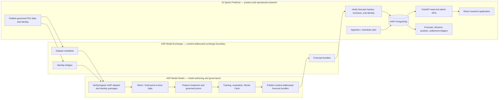
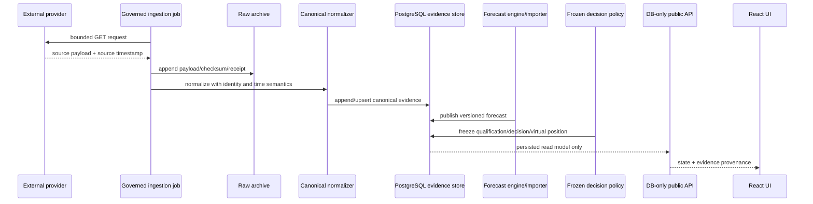
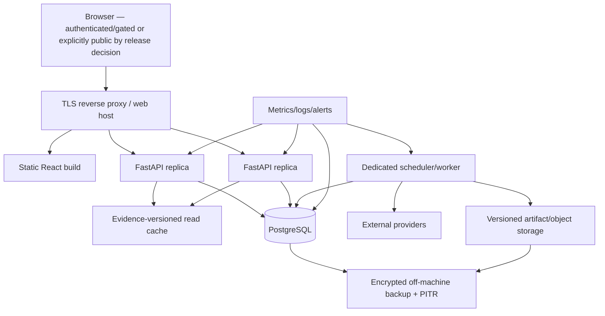

# AI Sports Predictor — Project Management Technical Handoff

**Snapshot date:** 2026-09-06 (America/New_York)  
**Audience:** replacement project-management agent, technical leads, and James  
**Purpose:** provide a source-grounded operating picture of the AI Sports Predictor (AISP), its upstream Model Studio, its exchange boundary, the current running state, unresolved decisions, and the recommended execution order.

## 1. Executive status

AISP is a substantial, functioning local-first sports forecasting and research platform. Its MLB vertical slice is operating against live schedules, weather, sportsbook evidence, forecasts, governed virtual-position experiments, settlement, performance reporting, and an observational Kalshi/Polymarket research layer. An NFL pipeline also exists, but only as an explicitly unfunded research shadow. NBA, WNBA, and UFC are registry placeholders rather than implemented products.

The platform is **not a wagering or trading system**. It has no sportsbook account integration, wallet, order-routing endpoint, or real-money execution path. All bankrolls and positions are virtual research ledgers. The prediction-market integration is credential-free, read-only, and observational; it must remain excluded from predictive inputs and execution until separately governed.

The correct readiness classification is:

| Boundary | Current classification | Meaning |
|---|---|---|
| Trusted local/private research | **RUNNING / DEGRADED** | The local frontend, API, PostgreSQL database, scheduler, data ingestion, forecasts, research views, and virtual ledgers are responding, but automatic restart is broken. |
| Product functionality | **INTEGRATED / INCOMPLETE** | The main MLB experience, Market Pulse, experiments, performance, history, and NFL shadow views exist; named correctness and release gaps remain. |
| Shared authenticated alpha/beta | **BLOCKED** | Recovery, scheduler ownership, security hardening, build health, rights review, and several integrity defects remain. |
| Public production | **NOT_READY** | The current deployment is a developer workstation with an embedded scheduler and development servers; no production hosting, TLS boundary, remote/CI release path, managed backup/PITR, or certified concurrency tier exists. |
| Model promotion | **PROMOTION_CLOSED** | The operational ensemble remains `DEVELOPMENT`; the stronger offline challenger remains research-only; current Model Studio work has not been promoted into AISP. |

An independent audit of the current AISP primary head reported **23 findings: 0 P0, 4 P1, 16 P2, and 3 P3**. Four important findings have since been repaired and tested on a descendant branch, but that repair branch has **not** been integrated into the primary checkout and its migration has **not** been applied to the operational database. This distinction is the most important fact for the incoming manager.

The immediate management objective should not be feature expansion. It should be to stabilize the broken restart/supervision path, establish a recoverable, secure, reproducible release baseline, integrate the completed critical repairs safely, separate scheduling from the API process, and close the remaining integrity/build defects. Only then should the project pursue shared-user deployment or promote a new modeling authority.

**Urgent live-operations alert:** the API was healthy when observed, but its configured restart wrapper was simultaneously crash-looping every ten seconds because it invokes an Anaconda Python environment that lacks `pydantic_settings`. The already-running API process is masking this defect; if it exits, the configured recovery path cannot restart it. `C:\Users\james\AppData\Local\asp\backend.log` was already approximately 62.9 MB and growing. In addition, the Compose API health check calls an admin-only endpoint without a token, receives 401, and prevents the dependent client container from starting. These are immediate resilience defects, not theoretical production improvements.

## 2. Scope: three separate systems

The project is an ecosystem, not one repository. Preserve these boundaries.

### 2.1 AI Sports Predictor

**Location:** `C:\Users\james\ai-sports-predictor`  
**Role:** product application, operational data collection, governed research decisions, virtual-position ledger, settlement, performance, and user experience.

AISP consumes verified artifacts and forecasts. It must not silently become a model-authoring workspace, accept executable model payloads, or share Model Studio's database or credentials.

### 2.2 ASP Model Studio

**Location:** `C:\Users\james\asp-model-studio`  
**Role:** upstream sports-data acquisition, point-in-time dataset construction, feature governance, empirical-Bayes priors, model research, evaluation, Monte Carlo scoring, and publication.

The newest important MLB prior work is on a separate coherent descendant worktree, not on the currently checked-out Model Studio branch. That work reports 21 executable governed prior features, three scientifically retired features, zero remaining prior-evidence blockers, and 16 unrelated feature/policy blockers that keep `canAdopt=false`. It is a completed modeling foundation, not an AISP production promotion.

### 2.3 ASP Model Exchange

**Location:** `C:\Users\james\asp-model-exchange`  
**Role:** filesystem exchange containing content-addressed dataset manifests, identity bridges, and forecast bundles.

This directory is not currently a Git repository. Its artifacts use SHA-256-addressed identities and explicit contract versions. Integration is bidirectional by artifact class, but each publication path is one-way and fail-closed: AISP publishes governed historical FD1 datasets and identity bridges for Model Studio; Model Studio publishes immutable forecast bundles for AISP research-shadow import. Neither application is an online RPC dependency of the other.

Observed exchange inventory:

- canonical MLB FD1 manifest `1b58d5d1def2c9b79041472974e93bc9a0f4c5317210099c1b1ee531fbfe8b49`: valid, 329 Parquet files, 3,738,096 rows, and 337,421,353 Parquet bytes;
- older `6c6cde072028c227d2372f950f30dcf3bd652be2efa92b9a2894c4660d22efc4`: valid immutable history but explicitly superseded and not eligible for new registration;
- identity bridge `6b69e7dcf4c5db7615420ee9f6f6f797b0335e31ab475646291f3a4cf90c52cf`: 2,692 players, 13,460 aliases, and exact resolution of all 4,633,762 declared references;
- NFL V2 index: 57 current and 285 historical bundles, all indexed as `RESEARCH_SHADOW` / `researchShadowOnly=true`.

One SHA directory was inaccessible to the audit account, but it was not referenced by either current or historical NFL index. The immutable SHA-addressed package/bundle directories are append-only authority. Locator/index files are intentionally mutable navigation aids that governed publisher code replaces atomically; they confer no scientific authority. Never manually modify an authority object or replace content inside a hash-addressed directory. Do not use the exchange as a general shared mutable application directory.

The live AISP configuration currently points `NFL_MODEL_STUDIO_ROOT` at the mutable Model Studio primary checkout (`33cd85f...`) and the NFL exchange root at `aisp-daily-forecast-bundles`; the generic shadow import directory is blank. The producer records the actual full Studio HEAD and verifies tracked-tree cleanliness, while the AISP consumer pins model/feature hashes and refuses promotion/execution. However, the producer does not use a separate allowlisted commit, and its tracked-tree check ignores untracked files. Production isolation should prevent Python/module shadowing and should pin an approved producer revision. No MLB Wave 2 prior/model is deployed into AISP through this configuration.

## 3. Evidence conventions for all future management reports

Every status report should use these exact categories:

| Label | Definition |
|---|---|
| **RUNNING** | Observed from the live local API/database at a stated time. It is not a future uptime guarantee. |
| **DEGRADED** | The main path responds, but a named reliability, evidence, or recovery capability is impaired. |
| **INTEGRATED** | Present on the selected AISP integration branch and compatible with its migration head. |
| **INCOMPLETE** | Material product behavior exists, but explicitly named functionality or release gates remain. |
| **READY_TO_INTEGRATE** | Implemented and tested on a descendant branch, but absent from the selected integration line and/or operational database. |
| **RESEARCH_ONLY** | Valid research evidence that is prohibited from operational promotion by its governing policy. |
| **HELD_CLOSED** | Technically present but intentionally ineligible until a human authority decision is recorded. |
| **PLANNED** | Registry/design exists; implementation or data authority does not. |
| **BLOCKED** | A named unmet control prevents the claimed outcome. |
| **NOT_READY** | Required release controls have not passed for the stated boundary. |
| **PROMOTION_CLOSED** | Model or policy promotion is prohibited pending an explicit governed decision. |

Never collapse `READY_TO_INTEGRATE` into `INTEGRATED`, or `RESEARCH_ONLY` into `PRODUCTION`. Never infer that a clean test receipt on a worktree changed the live database.

## 4. Repository and lineage state

### 4.1 AISP primary checkout

| Item | Observed state |
|---|---|
| Repository | `C:\Users\james\ai-sports-predictor` |
| Current branch | `codex/multisport-platform-architecture` |
| Current HEAD | `8826f4d475cfa2fa644996b9da26f147f4acb01e` |
| `main` HEAD | `92f92dde5d5ec6b8d1d68e9d69284368dbd0525b` |
| Remote | None configured |
| Migration head in primary | `20260904_0026` |
| Working tree | Tracked tree clean; two pre-existing untracked files are intentionally preserved |
| Preserved untracked files | `docs/MONTE_CARLO_SIMULATION_THEATER.md`, `install-supervision.ps1` |

The current primary branch is the de facto integration line and is substantially ahead of `main`. It contains a long linear history integrating the multisport daily hub, Model Studio forecast shadow board, live availability, virtual bankroll V1/V2.1, NFL M1 research shadow, prediction-market observer, Market Pulse, experiment credibility experience, semantic authority, pregame evidence, and overnight capture fixes.

There is no configured remote or CI release authority. That lowers immediate external exposure, but it also means there is no off-machine source backup, protected branch, automated gate, or canonical collaborative origin. **Do not add or push a remote until credential rotation and the approved history-remediation procedure are complete**, because credential-bearing material exists in historical commits even though the repair branch redacts the current tree.

### 4.2 Critical repair descendant

| Item | State |
|---|---|
| Worktree | `C:\Users\james\worktrees\aisp-critical-integrity-repair-v1` |
| Branch | `claude/aisp-critical-integrity-repair-v1` |
| HEAD | `6ec1bd43dec096c6b9c68dc90c103c6563664845` |
| Relationship | Direct descendant of AISP primary HEAD `8826f4d...` |
| Verdict | `AISP_CRITICAL_SECURITY_AND_INTEGRITY_REPAIR_V1_READY` |
| Merged/pushed | No |
| New migration | `20260905_0027` |
| Migration applied to live DB | No |

Commits on this branch:

1. `f4e90a6` — eliminate shared database defaults and fail closed without explicit configuration.
2. `8d70752` — add PostgreSQL immutability triggers for six authoritative tables.
3. `0609b66` — make team-rating finalization idempotent and quarantine conflicts.
4. `0f33a4b` — represent missing sportsbook evidence as unavailable/null, never 0%.
5. `7f6698e` — focused security and integrity tests.
6. `af92bd8` and `6ec1bd4` — repair evidence, contracts, integration instructions, and final SHAs.

This branch addresses:

- `SEC-DB-001`: committed shared database credential/defaults;
- `INT-001`: raw/Core SQL could bypass ORM-only immutability;
- `INT-007`: missing sportsbook evidence appeared as a reviewed 0% quote;
- `INT-008`: recurring finalization could fail on team-rating uniqueness conflicts.

The repair report's numbered summary originally calls documentation commit `af92bd8` the final head; follow-up commit `6ec1bd4` exists specifically to record the final commit identities. Use the Git-observed branch head `6ec1bd43dec096c6b9c68dc90c103c6563664845` as authoritative.

Safe integration requires more than merging source:

1. Establish and verify a recoverable backup or isolated clone.
2. Review the branch and rerun focused/full suites against disposable PostgreSQL.
3. Give every installation an explicit `DATABASE_URL`; development and production will otherwise fail closed.
4. Validate and apply migration `20260905_0027` during a maintenance window. It installs database triggers over authoritative tables.
5. Restart and verify ingestion, forecasts, decisions, positions, settlements, and read endpoints.
6. Rotate any credential that may have used the historical shared/default value.
7. Execute the separately authorized history-sanitization plan before establishing the first remote.

Do not fast-forward this branch onto `main` as an isolated code-only action.

### 4.3 Worktree hygiene

Numerous historical feature and audit worktrees remain registered. Most relevant feature heads are ancestors of `8826f4d...`, while the critical-repair worktree is a newer descendant. The incoming manager should create a lineage inventory, designate one integration branch, tag evidence-producing heads, then retire only worktrees proven merged and no longer needed. Never delete a worktree merely because its feature appears integrated; preserve receipts and untracked evidence first.

### 4.4 Model Studio lineage

| Item | State |
|---|---|
| Primary checkout branch | `codex/mlb-governed-prior-engine-v1` |
| Primary checkout HEAD | `33cd85fa5074efeec3077036baea9c8b2ef86bdf` |
| Latest coherent player-prior worktree | `C:\Users\james\asp-model-studio\.tmp\asp-player-prior-wave2` |
| Wave 2 branch | `codex/mlb-player-prior-wave2` |
| Wave 2 HEAD | `bff19a8a657bc96dea0469fad481acdcb4234386` |
| Wave 2 verdict | `MLB_PLAYER_STATE_PRIOR_WAVE2_READY` |
| Latest implementation repair | `codex/model-studio-tenant-workflow-repair-v1` at `9f02e6835f578b13d0429d0a7442b3634048f8f2` |
| Latest lineage/verification head | `claude/model-studio-tenant-repair-independent-verification` at `7ba66bfbb3baf3c6045f2ca42b8a5a0b07760d2f` |

The coherent Model Studio implementation chain is linear:

`main 924db29` → `33cd85f` governed prior V1 → `0900665` interaction authority → `64a74be` Wave 1 → `bff19a8` Wave 2 → `9f02e68` tenant/project workflow repair → `7ba66bf` verification documentation.

The Wave 2 branch was deliberately started from a coherent descendant that included the feature-treatment specification, player-state prior authority, interaction-recomputation authority, persistence, tests, and UI contracts. The later tenant/project repair closes self-grant takeover, ACL disclosure, active-project route scoping, project-bound downstream execution, canonical Wave 2 publication, and several concurrent create/update/revocation races. Independent verification gives the bounded verdict `ASP_MODEL_STUDIO_REPAIR_INDEPENDENTLY_VERIFIED_GO_FOR_INTEGRATION`.

Neither `9f02e68` nor the verification commit has been merged into the Model Studio primary checkout, pushed, or deployed. The verdict is an integration verdict, not a broad production certificate. Future modeling work must continue this lineage discipline; do not rebuild completed interaction work independently or omit it.

## 5. Product intent and non-negotiable invariants

AISP should be managed as an evidence-driven forecasting laboratory with an honest consumer-facing research interface. The core invariant is not “always produce a pick”; it is “never present unavailable, stale, unreviewed, or methodologically ineligible evidence as a qualified decision.” A day with no position is a valid and expected outcome.

Non-negotiable invariants:

1. **No real-money execution.** Virtual research only unless a future project explicitly creates and governs a separate execution product.
2. **No provider calls from public reads.** Public routes read persisted evidence. Ingestion and external calls occur only in controlled jobs/admin workflows.
3. **GET/read surfaces do not mutate authority.** The known `SEC-01` exception is the public semantic-template GET, which can seed and commit missing rows; it must be repaired without weakening the separate provider-egress invariant.
4. **No fallback from provider failure to demo data.** State must remain explicit: `LIVE`, `EMPTY`, `UNAVAILABLE`, `DEGRADED`, `DEMO`, or `RESEARCH_SHADOW` as applicable.
5. **Point-in-time integrity.** Features and forecasts must use only evidence available before the decision timestamp. Final/outcome evidence may settle or evaluate; it must never leak into pregame features.
6. **Append-only authority.** Published forecasts, model identities, experiment decisions, official positions, settlement results, and hash-addressed exchange objects are evidence, not editable application records. Mutable exchange locators are navigation only.
7. **Exact identity.** Dataset, feature, model, forecast, policy, decision, and position records must retain explicit versions/checksums.
8. **Research/policy separation.** A model probability does not itself authorize a position. A frozen policy, evidence gates, market authority, and stake rules are separate layers.
9. **Prediction-market separation.** Kalshi/Polymarket observations remain observational and excluded from forecasting inputs. No credential, order, account, or trade path should be added under the present scope.
10. **Repository separation and directional contracts.** AISP publishes governed FD1 dataset/identity packages for Model Studio registration; Model Studio publishes forecast bundles for AISP shadow import. The exchange carries the immutable objects and mutable non-authoritative locators. Do not share databases, credentials, mutable authority directories, or executable payloads.
11. **Human authority stays human.** `HELD_CLOSED` semantic templates and promotion gates require explicit decisions; an agent must not infer approval from a favorable review packet.

## 6. Technical architecture

### 6.1 Stack

**Backend:** Python 3.12, FastAPI, Pydantic v2, SQLAlchemy 2, PostgreSQL 16, Alembic, httpx, APScheduler, NumPy, scikit-learn, XGBoost, joblib, Polars, PyJWT, Argon2, and structured logging.

**Frontend:** React 18, TypeScript 5.7, Vite 6, React Router 7, and ECharts. Major pages are lazy-routed.

**Local deployment:** Vite development server, one FastAPI process, PostgreSQL, and an APScheduler instance embedded in the API process. This is appropriate for a private workstation research environment, not for public production.

Provider-capable features are controlled by explicit settings. Odds polling, Statcast, the scheduler, live shadow workflows, NFL shadow production/import, NFL odds, official virtual positions, and the prediction-market observer default off in code and must be enabled deliberately by environment. Production validation requires PostgreSQL, a sufficiently strong application secret and admin password, demo mode off, and explicitly safe HTTPS CORS origins. The current live local environment enables a subset of these gates; code defaults must not be mistaken for observed runtime state.

### 6.2 Backend module boundaries

The backend under `server/app` is organized into domain modules including:

- `analytics` — performance and comparative metrics;
- `api` — public/admin routing and response schemas;
- `audit` — evidence and operational receipts;
- `bankroll` — virtual policies, positions, settlement, and bankroll chains;
- `core` — configuration, authentication, logging, and shared controls;
- `data_sources` — external adapters and governed source boundaries;
- `db` and `models` — persistence, migrations, and ORM definitions;
- `features` — operational feature materialization;
- `forecast_exchange` — external forecast-bundle validation/import;
- `forecasting`, `modeling`, and `training` — baseline/ensemble and research workflows;
- `gen2`, `historical`, and `prospective` — staged research authorities;
- `ingestion` and `jobs` — provider collection, normalization, orchestration, and finalization;
- `markets` and `prediction_markets` — sportsbook and crowd-market evidence;
- `sports` — multisport registry and sport-specific behavior;
- `services` and `schemas` — application services and typed contracts.

High-value implementation index for orientation:

| File, relative to its repository | Responsibility |
|---|---|
| AISP `server/app/main.py` | FastAPI composition, middleware, health/readiness, scheduler startup |
| AISP `server/app/api/routes.py` | Central public/auth/admin HTTP surface |
| AISP `server/app/jobs/orchestrator.py` | Provider-capable workflows, job receipts, finalization, forecast/settlement orchestration |
| AISP `server/app/jobs/scheduler.py` | Embedded APScheduler registration and single-owner assumptions |
| AISP `server/app/models/entities.py` | Main relational domain/evidence schema |
| AISP `server/app/audit/immutability.py` | ORM-level authoritative-record mutation guards |
| AISP `server/app/services/forecast_service.py` | Operational MLB forecast construction/publication |
| AISP `server/app/forecasting/ensemble.py` | Gate-2 ensemble and deterministic boosting-compatible fallback |
| AISP `server/app/forecast_exchange/importer.py` | Strict Model Studio forecast-bundle import |
| AISP `server/app/gen2/exchange/publisher.py` | Governed FD1 dataset publication toward Model Studio |
| AISP `client/src/App.tsx` | React providers and route composition |
| AISP `client/src/services/api.ts` | Typed frontend HTTP façade and session-token attachment |
| Model Studio `server/sports_datasets/consumer.py` | Strict FD1 package verification/registration |
| Model Studio `server/sports_gold/nfl_shadow_exchange.py` | Content-addressed NFL shadow publication and mutable locator update |

The largest change hotspots include the central route file, `models/entities.py`, the principal read service, and the job orchestrator. Preserve domain-level tests when extracting these into smaller ownership units.

### 6.3 Data flow

Raw responses are archived with checksums and then normalized into canonical, time-aware records. Feature snapshots and forecasts retain lineage. Decision policies assess forecasts against governed market/evidence conditions. Qualifying decisions may create immutable virtual positions, which later settle from official final evidence. Public UI reads should never trigger provider activity.

### 6.4 Database character

The independent audit observed approximately 3.87 GB, 111 tables, 451 indexes, and 709 constraints. A later live query on 2026-09-06 measured approximately 3,996 MB. The schema is evidence-heavy: raw/normalized provider records, schedules, feature snapshots, models, forecasts, experiments, decisions, positions, results, prediction-market mappings/snapshots, job runs, and audit receipts.

Current allocation/growth requires immediate investigation:

| Relation/evidence family | Observed allocation or rows |
|---|---:|
| `fd1_recovery_identity_stage` | 742,259 exact rows / approximately 1,615 MB |
| `open_data_identity_mappings` | 736,056 exact rows / approximately 678 MB |
| Prediction-market consensus | 1,046,946 exact rows at 2026-09-06 11:12 ET / approximately 271 MB |
| Prediction-market alerts | 174,426 rows / approximately 97 MB |
| Prediction-market snapshots | 153,294 exact rows at 2026-09-06 11:12 ET / approximately 201 MB |

The two identity/recovery relations account for approximately 2,293 MB of allocated storage across roughly 1.48 million rows. On 2026-09-05 alone, the prediction-market workflow created 602,120 consensus and 100,732 alert rows; the partial 2026-09-06 day had already created 255,127 and 51,911 respectively. This suggests a cardinality/cadence/retention problem, but it is not permission to delete or compact evidence. First trace references, authority semantics, backup/restore impact, replay needs, and whether the rows are duplicated, derivable, or authoritative; then adopt a governed retention/compaction design.

The data model intentionally favors traceability over in-place updates. The primary branch currently relies partly on ORM guards; the critical repair branch adds PostgreSQL `BEFORE UPDATE OR DELETE` triggers to six central authority tables:

- `forecasts`;
- `model_versions`;
- `shadow_experiments`;
- `shadow_experiment_decisions`;
- `official_asp_positions`;
- `position_results`.

That migration is essential because bulk SQL can bypass ORM event hooks.

The six triggers are targeted defense-in-depth, not complete database enforcement of every ORM append-only type. The runtime role currently has `INSERT`, `UPDATE`, and `DELETE` privileges on all checked authority tables. Odds snapshots, model evaluations, prediction-market snapshots/consensus/alerts, and other ORM-protected records remain outside migration `0027`. A later least-privilege/trigger program must inventory every authority family and prove legitimate transitions before expanding coverage.

### 6.5 Public and admin API boundary

Public read surfaces include configuration, sports registry, today/daily hub, games, markets, performance, history, bankroll/experiment summaries, shadow board, prediction-market board/timelines/coverage, and the qualification funnel. Admin routes invoke ingestion jobs, mapping review, and semantic authority decisions.

The design rule is DB-only public reads with provider I/O isolated to jobs. `provider_calls_made=0` is surfaced in relevant read receipts. The known `SEC-01` violation is a public GET for semantic templates that calls an `ensure_seeded()` path and may write seed rows. Move seeding to a migration or explicit admin/startup authority and make the GET provably read-only.

### 6.6 Authentication and authorization

- Email/password authentication using Argon2 password hashes.
- JWT access tokens signed with HS256.
- `MEMBER` and `ADMIN` roles.
- User role, status, and token version are re-read from the database, allowing revocation and role changes to take effect.
- Production configuration fails closed for an insecure secret, demo mode, unsafe CORS, or non-PostgreSQL storage.

Authentication protects account/admin operations, but it does **not** currently gate the main research reads. Today, sports registry, games, market board, performance, and related core product endpoints have no `CurrentUser` dependency and are anonymously readable on any network interface that can reach the API. Accounts and entitlements therefore do not make the current product an authenticated beta. The release owner must choose whether these reads remain intentionally public or become entitlement-gated.

Current frontend sessions are stored in `sessionStorage`. This is tolerable only within the present private boundary. The current rate limiter is also process-local/non-distributed and fails open if its own internal operation errors; multiple API replicas would have independent counters. A shared/public deployment should move to secure HttpOnly/SameSite cookies with CSRF protection, complete account flows, prevent email-enumeration behavior, adopt a distributed fail-closed-or-explicitly-degraded limiter with bounded key retention, and add MFA/admin hardening as required.

### 6.7 Payments and entitlements

AISP is not connected to payments. There is no Stripe, Patreon, billing, checkout, webhook, subscription-reconciliation, refund, or cancellation implementation or dependency. `Entitlement` currently exists only as a database schema; the main read routes do not enforce it. The account UI hardcodes “Phase 1 access” and states that provider integrations are deferred. Consequently, `PREMIUM` or similar labels are not operational paid-access tiers.

Before any paid beta, implement server-authoritative entitlement checks, signed and idempotent payment-webhook evidence, subscription/refund/cancel/expiry semantics, reconciliation, an auditable ledger, privacy/support flows, and end-to-end tests. Payment work must remain separate from real-money wagering, which is out of scope.

## 7. User experience and product surfaces

Current routes include:

| Route | Purpose |
|---|---|
| `/` | Multisport Daily Command Center: qualified positions, awaiting evidence, sport health, and honest no-position states. |
| `/mlb` | MLB market/forecast board. |
| `/research/history` | Historical evidence and research lineage. |
| `/games/:gameId` | Game-level forecast, market, evidence, and status detail. |
| `/markets` | Sportsbook market board. |
| `/performance` | Operational and offline research metrics. |
| `/shadow-board` | Imported research-shadow forecasts, currently including NFL. |
| `/market-pulse` | Prediction-market research board. |
| `/market-pulse/:gameId` | Provider comparison, movement timeline, capture matrix, and reconciliation detail. |
| `/experiment` | Frozen policy comparison and virtual-bankroll evidence. |
| `/methodology` | User-facing methodology and limitations. |
| `/admin` | Admin-only jobs, mappings, and authority controls. |
| `/account`, `/login` | Authentication/account surfaces. |
| `/demo/*` | Explicit opt-in demonstration routes; never a silent live fallback. |

The product's best design decision is that the UI distinguishes missing evidence from negative evidence. Examples include “awaiting final evidence,” “not quoted,” “unreviewed,” `NOT_DUE`, and `RESEARCH_SHADOW` rather than fabricating a probability or recommendation. The critical repair branch restores this rule for missing sportsbook comparisons.

## 8. Sports and source status

### 8.1 Registry status observed 2026-09-06

| League | Availability | Official virtual positions | State |
|---|---|---|---|
| MLB | `LIVE` | Supported only through the existing governed experiment | Operational local vertical slice |
| NFL | `RESEARCH_SHADOW` | No | Imported Model Studio forecasts plus governed odds; unfunded |
| NBA | `PLANNED` | No | No model, acquisition, or product surface |
| WNBA | `PLANNED` | No | No model, acquisition, or product surface |
| UFC | `PLANNED` | No | Individual-participant modeling not implemented |

NHL is not implemented and should not be implied by “multisport.”

### 8.2 Provider/source inventory

| Source | Use | Important constraints |
|---|---|---|
| MLB Stats API | Schedules, probable pitchers, official status/finals, box-score evidence | Archive raw evidence and preserve source timestamps/identity. |
| Open-Meteo | Weather | Weather is contextual evidence and must retain observation/forecast time. |
| The Odds API | Sportsbook h2h, spread, and total quotes | Keyed/quota-limited; jobs only; distinguish unavailable from 0; record call budgets. |
| Retrosheet / Chadwick / Lahman / NOAA | Historical/open-data modeling inputs | Preserve attribution and source-specific limitations. |
| Baseball Savant / Statcast | Governed player/pitch evidence | Default-off in some AISP paths; local research restrictions and commercial-rights review apply. |
| Kalshi public API | Read-only prediction-market observation | Credential-free GET only; no trading; semantic template held closed. |
| Polymarket public API | Read-only prediction-market observation | Credential-free GET only; no trading; semantic template held closed. |
| SportsDataIO injuries | Previously explored | Deliberately deferred/off; do not describe as an active authority. |

Rights for combined artifacts must be computed as the intersection, or most restrictive applicable authority, of all component sources. The Model Studio companion publication combines FD1/Lahman and Statcast-derived evidence and therefore retains `LOCAL_PRIVATE_MODEL_DEVELOPMENT`, attribution obligations, `GOVERNED_LOCAL_RESEARCH_ONLY` for MLB Statcast material, and an explicit commercial-rights review requirement. Never describe the companion or downstream AISP use as more permissive than its source registrations.

## 9. Forecasting and model governance

### 9.1 Operational MLB model

The running operational model is:

| Field | Value |
|---|---|
| Name | `asp_mlb_ensemble` |
| Version | `2.0.0-gate2-08cca634c81b` |
| Status | `DEVELOPMENT` |
| Component weights | record-strength baseline 0.30; run expectation 0.45; deterministic untrained development fallback (“boosting-compatible”) 0.25 |
| Simulation | Seeded Monte Carlo; default 20,000 draws; configured seed 20250601 |
| Calibration | No fitted calibrator is used in the live Gate-2 path; Platt calibration belongs to the separate offline Gate-3B research workflow |
| Core metrics | Brier score, log loss, expected calibration error, accuracy, run MAE, total MAE |

`ForecastService` constructs the ensemble without an injected boosting estimator, so the “boosting-compatible” component follows hard-coded deterministic development logic and persists `trained_artifact=false`. The model registry describes it as not trained. The system must not present it as a fitted gradient-boosting model or market `DEVELOPMENT` probabilities as proven predictive advantage. Model probability is one evidence component; position qualification also depends on complete two-sided quotes, no-vig conversion, freshness, eligibility, policy thresholds, and a frozen decision time.

### 9.2 Live operational evaluation observed 2026-09-06

| Metric | Value |
|---|---:|
| Evaluated games | 62 |
| Brier score | 0.2535917597 |
| Log loss | 0.7004842780 |
| Accuracy | 50.0% |
| Run MAE | 3.9711497393 |
| Total MAE | 3.6542052229 |

The sample is small, and these values do not demonstrate an edge. The component table currently shows the deterministic “gradient_boosting_challenger” fallback ahead of the ensemble on this sample. Because that component is untrained, the comparison is a diagnostic of the fixed development formula, not evidence about a learned gradient-boosting estimator and not a promotion signal.

### 9.3 Offline Gate 3B research challenger

The immutable Gen-1 research evaluation used a strict A2 artifact:

- 2,428 Tier-A rows;
- 1,923 development games;
- 16 rolling-origin folds;
- 505-game locked holdout;
- dataset identity `mlb-gate3-a2-3059f81db1d0e278`;
- model identity `mlb_gen1_research vgen1-evaluated-66c50c8f9a09fc54`.

Holdout metrics:

| Metric | Value |
|---|---:|
| Brier | 0.2418938277 |
| Log loss | 0.6766197599 |
| ECE | 0.0828263829 |

The selected run-strength baseline was slightly worse than the simple Poisson baseline in Brier and log loss. The formal result is `RESEARCH_CHALLENGER` and `RESEARCH_ONLY_NO_PROMOTION`. The frozen research policy forbids treating this evaluation as a live promotion.

### 9.4 Historical gate progression

The major MLB milestones are:

1. **Phase 1:** full vertical slice with operational forecasts, market evidence, virtual decisions, and UI.
2. **Gate 2:** live point-in-time slice and operational ensemble.
3. **Gate 3:** provider-free prospective training audit; insufficient labeled evidence, no promotion.
4. **Gate 3A/A1:** 2025 historical warehouse with 2,430 official finals, 4,860 team-game rows, and 127,872 player-game rows.
5. **Gate 3A/A2:** strict 2,428-row Tier-A artifact and enhanced Tier-B shadow; initial readiness failed required feature-family coverage.
6. **Gate 3B:** rolling-origin research challenger; no promotion.
7. **Gate 3C:** player/event foundation.
8. **FD1:** free-data 2021–2025 foundation finalized as `READY_WITH_DOCUMENTED_FREE_DATA_LIMITATIONS`.
9. **X1/X2:** content-addressed dataset exchange and cross-repository identity bridge.
10. **Model Studio governed-prior waves:** exact player-state/interaction authority and estimator engines, still upstream of AISP promotion.

### 9.5 Latest Model Studio prior authority

Wave 2 reports ten newly executable governed prior features in addition to eleven Wave 1 features. Its estimator families include:

- Dirichlet-multinomial empirical Bayes;
- Dirichlet-multinomial component shrinkage;
- Gamma-Poisson component shrinkage;
- Normal-normal empirical Bayes.

The ten Wave 2 bindings cover pitcher WHIP, starter appearance rate, batter SLG/AVG, fastball velocity, pitcher/batter whiff rates, and full pitch-composition usage. Pitch composition explicitly includes the residual `other_or_unclassified` category so the Dirichlet composition sums to all pitches. Velocity aggregates remain floating-point; counts remain exact integers.

The authority is fitted fold-locally from training-only evidence, content-addressed, tested for leakage/tampering, and keeps final OOT payloads sealed/unmaterialized. Three fields are scientifically retired and nonselectable, while preserving definitions and audit evidence:

- `pitcher_era9`;
- `batter_obp`;
- `batter_last100_contact_rate`.

Wave 2 status reconciliation:

| Category | Count |
|---|---:|
| Fully executable governed priors | 21 |
| Binding-ready awaiting estimator | 0 |
| Retired by scientific decision | 3 |
| Blocked by missing prior evidence | 0 |
| Other blocked fields outside prior-evidence work | 16 |

The final V2 prior-authority checksum is `9d9cfaf34f87be67f7d3ab2b8b024d83a6fc5e8abe0dde8de7be0866f1b8366e`, and the combined treatment is preserved as immutable V8 `DRAFT`. `canAdopt` remains false. Wave 2 did not register an AISP model, adopt a policy, open final OOT, promote a model, or prove challenger lift. The new manager should treat it as an eligible upstream research input for a future governed candidate—not a drop-in production replacement.

The 16 remaining treatment-adoption fields are not missing prior evidence. They comprise one field awaiting schedule point-in-time/invariant authority (`doubleheader_game_number`), one awaiting a registered effective-dated holiday authority, and 14 rivalry mappings awaiting explicit approve/reject decisions. Resolve and account for those categories separately; do not report them as Wave 2 estimator failures.

Model Studio also has broader platform blockers outside the tenant repair and feature-prior work: bootstrap/unregistered-actor integrity, fresh-project feature eligibility, warm-cache tamper behavior, database-level ledger/audit immutability, backup/restore, dependency and test-signal cleanup, worker isolation/queueing, authentication hardening, absolute runtime paths, and data-rights review. The security-patched backend did not receive an independent three-viewport live browser rerun. Effective rights remain `GOVERNED_LOCAL_RESEARCH_ONLY`. These do not invalidate Wave 2's scientific receipt, but they block treating Model Studio itself as production-ready.

### 9.6 Correct promotion path

Any future Model Studio candidate should follow this sequence:

1. Freeze the exact training dataset, feature authority, estimator identities, code revision, dependencies, seed, and rights manifest.
2. Verify all exchange hashes and cross-repository identity bridges.
3. Evaluate on policy-approved development/validation windows without opening final OOT.
4. Register a research candidate and compare against named baselines and the operational ensemble.
5. Run prospective shadow forecasts in AISP with no funding.
6. Accumulate enough settled evidence to evaluate calibration, discrimination, error, coverage, and operational reliability.
7. Convene an explicit promotion decision with rollback criteria.
8. Only after approval, create a new immutable operational model version and a separately frozen decision-policy experiment.

Never overwrite the identity of the current ensemble or silently switch an active experiment's model.

## 10. Decision policy and virtual bankroll experiments

The experiment layer deliberately separates forecasting from selection/staking policy.

### 10.1 V1 strict control

| Field | State observed 2026-09-06 |
|---|---|
| Experiment | `ASP MODEL BANKROLL — 2026 V1` |
| Policy | `AISP_OPPORTUNITY_POLICY_V1` |
| Role | `STRICT_CONTROL` |
| Starting/current bankroll | $1,000 / $1,000 |
| Decisions evaluated | 7,478 |
| Positions | 0 |
| Evidence state | `NO_EVIDENCE` |

The zero-position result is valid: the strict policy has not found a fully qualifying opportunity.

### 10.2 V2.1 practical pregame challenger

| Field | State observed 2026-09-06 |
|---|---|
| Experiment | `ASP PRACTICAL PREGAME BANKROLL — 2026 V2.1` |
| Policy | `AISP_PRACTICAL_PREGAME_POLICY_V2_1` |
| Relationship | Same model, different decision policy |
| Starting/current bankroll | $1,000 / $997.28 |
| Positions | 10 total; 9 settled; 1 open |
| Record | 3–6 |
| P/L | -$2.72 |
| Total stake | $25.00, including $2.50 open |
| Average CLV | approximately -0.153% on 5 settled samples |
| Evidence state | `EARLY_EVIDENCE` |

This is far too small a sample to distinguish skill from noise. No profitability or failure claim is justified.

The API's current headline ROI uses total risked, including the open stake: `-2.72 / 25.00 = -10.88%`. The independent audit identifies this as `INT-005`; a settled-only framing would use $22.50 and produce approximately -12.09%. The UI/API must name the denominator explicitly and should not compare open-risk-inclusive ROI with settled-only performance.

The original V2 policy was preserved immutably as `SUPERSEDED_BEFORE_ACTIVATION` with zero decisions and zero positions. That is correct evidence behavior.

However, all three experiment rows—V1, V2, and V2.1—currently have database `is_active=true`; V2 is presented as superseded through Python's `SUPERSEDED_POLICIES` exclusion rather than a persisted lifecycle/current-state transition. V2.1's persisted `policy_config` does already carry a `supersedes: AISP_PRACTICAL_PREGAME_POLICY_V2` pointer, but that pointer does not deactivate or reclassify V2. This code-versus-database authority split is fragile because every reader must remember the hard-coded exclusion. Retain the immutable supersedes pointer, add explicit persisted lifecycle/current status, and enforce or centrally prove a single-current-policy rule without rewriting historical decisions.

Additional unresolved experiment defects include exact model pinning (`INT-004`) and a failure mode when the expected V2.1 registration is missing (`INT-006`).

## 11. Current operational snapshot

The following was observed from read-only local HTTP calls on 2026-09-06. It is a point-in-time receipt, not a service-level guarantee.

### 11.1 Service state

- Frontend reachable at `http://127.0.0.1:5173`.
- API reachable at `http://127.0.0.1:8010`.
- `/healthz` returned 200 / `ok`.
- `/readyz` returned 200 / database reachable / scheduler running.
- Public configuration returned `data_mode=live`, `model_status=DEVELOPMENT`, and operational date 2026-09-06.

The sanitized live settings profile is intentionally mixed and must not be mistaken for production:

| Setting family | Observed state |
|---|---|
| Application profile | `APP_ENV=development`; `DEMO_MODE=true`; `BUILD_COMMIT` blank |
| Scheduling | Main scheduler on; event-relative scheduler off |
| MLB providers | Direct odds polling off; Open-Meteo on; Statcast off |
| Position/shadow gates | General official-position feature off; live shadow on |
| NFL | Shadow, odds, and Model Studio producer on |
| Prediction markets | Observer/public display, Polymarket, and Kalshi REST on |
| Public response provenance | `data_mode=live` because the displayed evidence is live, despite the development/demo-capable process profile |

This is a workstation development profile carrying live external evidence, not a production release. `DEMO_MODE=true` permits explicit demo behavior; it must never cause a provider failure to be mislabeled as live or silently replaced by demo data. The blank `BUILD_COMMIT` also means the running process does not self-report a release identity.

This healthy observation has a critical caveat. `C:\Users\james\AppData\Local\asp\start-backend.cmd`, the configured restart wrapper, invokes `C:\Users\james\anaconda3\python.exe`; that interpreter cannot import `pydantic_settings`. The wrapper was producing a ten-second crash loop in `C:\Users\james\AppData\Local\asp\backend.log`, which had grown to roughly 62.9 MB. The current API is a separately surviving process. Therefore “healthy now” and “recoverable after failure” are different states: the former passed, the latter failed.

### 11.2 Daily Command Center

At approximately 10:57 ET:

- 15 MLB games were present.
- All 15 were `AWAITING_FINAL_EVIDENCE` because no complete two-sided governed sportsbook quote was available.
- Zero decisions were final-qualified for the day.
- Zero new official positions were created that day.
- One previously created position remained open across the ledger.
- Latest complete refresh was 10:51:30 ET.
- No provider calls were made by the public read.
- MLB was live; NFL remained research shadow.

This is an honest no-position state, not an outage.

### 11.3 Known operational concern

The earlier independent-audit sample reported 74 cumulative/recent live finalization failures arising from team-rating uniqueness conflicts; its observation window differs from the later 24-hour receipt query in Section 11.4, which found 25. The exact source payload that introduced the conflict was inferred rather than captured during the audit. The critical repair branch reproduces the conflict and implements an idempotent/quarantining fix. Until integrated, recurring finalization and settlement reliability remain at risk; do not assume the single open position is necessarily settleable without checking the job receipt.

### 11.4 Current job-receipt health

A read-only receipt query at approximately 11:12 ET on 2026-09-06 found 2,100 succeeded and 108 failed job runs in the preceding 24 hours:

| Job/failure class | Failed receipts | Interpretation at observation time |
|---|---:|---|
| `refresh-odds` | 74 | Odds quota floor reached with eight calls remaining. The protective floor is intentional, but recording every guarded stop as a generic failure creates operational noise; latest run was still failed. |
| `finalize-games` | 25 | Team-rating uniqueness conflict addressed only on the unintegrated critical branch; latest finalization had subsequently recovered. |
| `discover-prediction-markets` | 4 | `uq_pm_contract_version` conflict; latest discovery had recovered. |
| Availability polling | 3 | Connection timeouts; latest availability run had recovered. |
| Finalization timeout | 1 | Connection timeout; later run recovered. |
| NFL producer | 1 | Could not resolve Model Studio HEAD; the 05:30 generation remained failed. |

This is mixed health, not a blanket outage and not a clean scheduler. Management should separate expected quota terminalization from actionable failure, retain the raw receipt, expose last-success age and consecutive failures, and investigate unresolved latest failures. A green `/readyz` only proves that the scheduler object is running and the database is reachable; it does not prove all workflows are current.

## 12. Prediction-market observer and Market Pulse

### 12.1 Scope

Kalshi and Polymarket are used only as public, credential-free research observers. The integration performs GET requests, discovers provider markets, maps them to canonical MLB games, archives time-stamped quotes/order-book evidence, and renders comparison/movement/capture views. There is no account, wallet, order, or execution code. Their values are excluded from the forecasting model.

### 12.2 Semantic authority

Two exact templates remain `HELD_CLOSED`:

- `KALSHI_MLB_FULL_GAME_WINNER` version 1;
- `POLYMARKET_MLB_FULL_GAME_WINNER` version 1.

Review packets recommend approval, but approval has not been executed. The material divergence concerns settlement/no-result semantics. Until James records an explicit approve/reject decision, observations remain `PREGAME_UNREVIEWED` and are ineligible for decision-grade consensus or gap calculations.

This closure is intentional and must not be bypassed by an agent, a seed operation, or a favorable data-quality result.

### 12.3 Discovery and capture

The current primary includes repairs for doubleheader/alias mapping, closed-market 404 retry storms, and scheduler starvation of narrow pregame cuts. The formal overnight report issued at 08:15 ET on 2026-09-05 was only `PARTIALLY_CERTIFIED` because later milestones were not yet due at report close.

Subsequent persisted runtime evidence observed on 2026-09-06 shows the complete 2026-09-05 slate achieved:

| Provider | Games | First discovered | T-6h | T-2h | T-30m | T-5m | Final valid pregame |
|---|---:|---:|---:|---:|---:|---:|---:|
| Kalshi | 15 | 15 | 15 | 15 | 15 | 15 | 15 |
| Polymarket | 15 | 15 | 15 | 15 | 15 | 15 | 15 |

All cells were `CAPTURED`; none were `MISSED_SCHEDULER_RUN` or `FAILED_PROVIDER_CALL`. This later read-only evidence closes the report's prior `NOT_DUE` gap, but the formal certification document remains stale/partial. Create an addendum rather than rewriting its historical verdict.

For the 2026-09-06 slate, the board remained `RESEARCH_OBSERVATIONS_UNREVIEWED`; both providers were active, but template closure prevented reviewed consensus.

### 12.4 Remaining observer risks

- `WF-002`: provider request budgets reset per invocation and do not fully account for failed calls.
- `WF-003`: alert records exist, but no delivered notification channel is proven.
- `SEC-01`: public semantic-template GET can seed rows.
- Mapping and capture quality do not establish legal/commercial reuse rights.
- Missing sportsbook evidence is still represented incorrectly on primary until the critical repair is integrated.

## 13. Independent audit findings

The independent audit at AISP HEAD `8826f4d...` is the most conservative and useful readiness authority. It issued no shared-alpha, beta, public, scale, backup/restore, or data-rights certificate.

### 13.1 P1 findings at audit time

| ID | Finding | Current disposition |
|---|---|---|
| `INT-001` | Bulk SQL bypasses authoritative-history immutability | **READY_TO_INTEGRATE** on critical repair branch; not live |
| `OPS-DR-001` | No managed recovery path for authoritative relational + artifact evidence | **OPEN** |
| `SEC-DB-001` | Shared database credential committed through installation defaults | Current-tree repair **READY_TO_INTEGRATE**; operational rotation/history remediation still **OPEN** |
| `WF-001` | Embedded scheduler lacks process ownership lease and shares API resources | **OPEN** |

The repair report describes `WF-001` among the remaining workflow findings even though the audit rated it P1. Keep its severity at P1 for project planning.

### 13.2 P2 findings

| ID | Finding | Disposition |
|---|---|---|
| `INT-002` | Closing-line selection can accept unavailable/suspended quotes | Open |
| `INT-003` | Away-only lineup changes may not emit availability/rescore events | Open |
| `INT-004` | Experiment does not pin the exact model identity strongly enough | Open |
| `INT-005` | ROI denominator includes open stake while presenting settled performance | Open |
| `INT-006` | Missing V2.1 registration can produce a 500 response | Open |
| `INT-007` | Missing sportsbook evidence rendered as 0% | Ready to integrate |
| `INT-008` | Team-rating finalization uniqueness conflict breaks recurring job | Ready to integrate |
| `SEC-01` | Public semantic-template GET may write seed data | Open |
| `SEC-02` | Registration response can disclose whether an email exists | Open |
| `SEC-03` | Legacy artifact trust permits traversable paths/adjacent manifests | Open |
| `SEC-04` | Some structured logging paths can bypass redaction | Open |
| `WF-002` | Prediction-market call budgets reset per invocation/omit failures | Open |
| `WF-003` | No delivered alert channel | Open |
| `WF-004` | Official frontend build blocked by TypeScript error | Open |
| `WF-005` | Source-use and attribution approvals incomplete | Open |
| `CAP-001` | No safe 100-concurrent-reader performance tier | Open |

### 13.3 P3 findings

- Rate-limiter buckets lack bounded eviction.
- A development-tooling dependency advisory affects pytest, not the production runtime.
- A failed sport registry load may remain cached for process lifetime.

## 14. Testing, build, capacity, and recovery evidence

### 14.1 Test posture at audited primary HEAD

- Backend: 1,482 passed, 47 failed test calls, 6 setup errors, and 8 skipped.
- The 61 non-pass records including skips were classified as 3 genuine unresolved defects, 11 pre-existing reproducible failures, 29 missing-local-fixture cases, and 18 environment-dependent cases.
- Frontend: 181/181 tests passed across 30 files.
- Focused integrity: 204 passed, with one migration test deselected.
- Focused security: 32 passed; independent security tests: 7 passed.
- Official TypeScript/build gate fails reproducibly with `TS2537` in `MarketPulsePage.reconciliation.test.tsx`; Vite bundling alone succeeds.
- The critical repair focused suites pass and add no dependencies; the same pre-existing TypeScript failure remains.
- The repair branch's broader run recorded 1,527 passed, 40 failed, 6 errors, and 8 skipped; its receipt classifies the remaining nonpasses as pre-existing/environment/fixture/genuine unresolved rather than claiming a green full suite.

The project should not report “all tests pass.” It should maintain an explicit allowlist for fixture/environment-dependent tests, fix the three genuine defects and official TypeScript failure, and require a clean reproducible release suite from an isolated checkout.

Test-inventory and harness limitations matter as much as raw pass counts:

- source inventory contains 139 backend test files with about 1,236 declared test functions and 30 frontend test files with about 170 declarations; parameterization explains why executed-test totals are larger;
- `scripts/verify.ps1` forces SQLite, then runs pytest, Vitest, and the frontend build, but has no backend coverage minimum, lint/type gate, dependency scan, secret scan, container scan, or database-security gate;
- the default backend fixture uses in-memory SQLite plus `create_all`, so it does not prove PostgreSQL migrations, triggers, roles, locking, or query behavior;
- PostgreSQL recovery rehearsal is opt-in and can skip when its environment is absent;
- no Playwright, Cypress, or comparable browser end-to-end suite exists;
- real exchange tests skip when sibling artifacts are missing, and at least one contract test depends on ignored local FD1 evidence;
- `test_gate3c_fd1_recovery_migration.py` still requires obsolete head `20260815_0015`, although primary/live is at `20260904_0026`; it should prove that `0015` remains in lineage rather than claim it is current head;
- `scripts/security_gate.ps1` runs only three pytest modules and is not a comprehensive secret/dependency/container/database security gate;
- coverage source is configured, but no minimum threshold is enforced.

Create separate fast unit, PostgreSQL integration/migration, exchange-fixture, browser E2E, security/supply-chain, and full-release lanes. Skips must be treated as named environmental evidence gaps, not silent passes.

### 14.2 Capacity evidence

At 100 concurrent readers in the audit environment:

| Surface | Approximate p95 |
|---|---:|
| Today | 9.9 seconds |
| Markets | 15.7 seconds |
| Market Pulse | 29.4 seconds |

The default pool reached 30 connections and the API process peaked around 720 MiB RSS. The empty experiment path produced widespread errors. The audit certified **no safe concurrent-user tier**. Earlier private-alpha estimates of 5–10 active users must not be generalized into a public capacity promise.

The likely architectural solution is an evidence-versioned read model/cache for expensive dashboard queries, a separate scheduler worker with an ownership lease, query-budget enforcement, and repeatable load tests against production-like infrastructure. Read replicas/PgBouncer are later-stage options, not substitutes for fixing expensive reads.

### 14.3 Recovery

A relational restore exercise successfully reproduced 111 tables and selected digests, but did not cover all referenced artifacts, roles/grants, locale/extension assumptions, automation, off-machine retention, encryption, or point-in-time recovery. Therefore it is evidence that PostgreSQL can be restored, not a recovery certificate.

`OPS-DR-001` should be the next dedicated repair:

- encrypted off-machine relational backups;
- versioned backup of every referenced artifact/exchange dependency needed to reconstruct authoritative state;
- retention and rotation policy;
- automated backup verification;
- isolated restore drill with roles/grants/extensions and application smoke tests;
- measured RPO/RTO;
- documented ownership and failure alerting.

## 15. Deployment and operations

Current topology is a developer workstation:

- Vite dev server;
- one FastAPI process;
- APScheduler embedded in that API process;
- local PostgreSQL;
- no reverse proxy or TLS termination;
- no orchestrated deployment or health-based restart authority;
- no remote repository or CI/CD;
- no managed backups/PITR;
- no production observability/alert delivery.

Two concrete deployment defects are already reproduced:

1. **Broken restart/supervision:** the configured wrapper uses the wrong Python runtime, fails on `ModuleNotFoundError: pydantic_settings`, retries every ten seconds, and grows an unbounded log while a separately launched API happens to remain alive.
2. **Broken Compose dependency health:** `docker-compose.yml` probes admin-only `/api/v1/health` without credentials. The endpoint returns 401, so the API container is never marked healthy and the dependent client does not start. The probe should target public `/healthz` or `/readyz`, with readiness semantics chosen deliberately.

The current Compose mounts also do not expose the Model Exchange or Model Studio roots to the API container, and a configured Windows Python path cannot execute inside a Linux container. NFL import/producer behavior is therefore native-local unless container-safe volumes and runtime configuration are explicitly designed. Do not describe Compose as a complete deployment path yet.

The database boundary also needs immediate verification. PostgreSQL reported `listen_addresses=*`, port 5432, `ssl=off`, and `archive_mode=off`, with listeners on `0.0.0.0` and `[::]`. Firewall and `pg_hba.conf` may still constrain access, but a loopback application URL is not proof that the database is local-only. Verify host firewall/HBA exposure, bind scope, and least-privilege roles. `archive_mode=off` means no WAL archive/PITR authority currently exists.

Runtime/documentation profiles have drifted. The observed native services use frontend 5173, API 8010, and PostgreSQL 5432, while README/Compose examples use API 8000 and a host database port of 5433. An unrelated local service was already answering 8000 with 503, so blindly following the README can test the wrong application. Establish one named canonical profile, run a port/process preflight, and make every receipt state the actual base URL, database target class, and build identity. The live frontend is Vite source, not the production Nginx/CSP path.

The build/deployment supply chain is not reproducible yet:

- Python requirements use broad version ranges rather than a locked, hashed resolution;
- setup uses `npm install` rather than a locked release install path;
- the backend Dockerfile declares no non-root `USER` and therefore runs as root by default;
- Compose performs `alembic upgrade head` and admin creation on every API boot instead of a separately approved migration/bootstrap job with a backup gate;
- `BUILD_COMMIT` is blank in the live process;
- ignored `client/dist` output predates current source and is not evidence of a current production build.

Adopt locked dependencies, SBOM/provenance, non-root containers, separately governed migrations, immutable build identities, and artifact scanning before treating a container image as a release.

Production configuration guards exist and are useful, but guardrails are not deployment architecture.

Recommended target topology:

The scheduler must have a database-backed ownership lease/advisory lock and stable job-window idempotency keys so only one worker owns each run. API replicas must not execute recurring jobs. Expensive read models should be built asynchronously and keyed to an evidence version so user traffic does not repeat large joins.

## 16. Known defects and management cautions

In addition to the formal audit findings:

- Automatic restart is currently nonfunctional and generating a large, growing crash log; fix the interpreter/service definition and add log rotation before relying on supervision.
- Compose health checks an authenticated endpoint anonymously and blocks its own client dependency.
- A historical Daily Command Center request emitted a 404 for `/api/v1/games/`; reproduce and either fix the caller or establish that the stale observation no longer applies.
- The formal prediction-market overnight certification is now behind the persisted evidence; issue an append-only addendum.
- The operational performance endpoint still exposes older historical-readiness language alongside a later completed research evaluation. Preserve both historical facts but make current status hierarchy clear.
- Source and rights approvals are incomplete; functionality is not equivalent to public redistribution authority.
- Database and test-artifact directories are large and include inaccessible temporary paths. Establish artifact retention/cleanup rules only after identifying authoritative receipts.
- Worktree sprawl creates provenance risk. Inventory before pruning.
- No remote means no off-machine source safety; a remote cannot safely be created until secret history is addressed.
- The current database migration head differs between primary (`0026`) and the repair branch (`0027`). Never run an arbitrary checkout against the operational database without checking compatibility.
- The live API's scheduler reports running, but readiness does not prove that every job window is succeeding. Monitor job receipts and age-of-last-success separately.
- `rebuild-features` currently validates/counts eligible games rather than rebuilding material feature data, while `run-simulations` aliases forecast generation and creates a new immutable forecast version. Rename or document these commands before handing them to operators.
- `api/routes.py`, `models/entities.py`, the main read service, and the job orchestrator are very large change hotspots. Domain concepts are separated, but code ownership and regression risk remain concentrated.
- Many product read routes are intentionally anonymous even though accounts and entitlements exist. Decide explicitly whether the next release is public research content or an authenticated private beta; do not assume frontend route visibility enforces server authorization.
- Exchange authenticity currently derives from trusted local roots, strict contracts, and pinned content hashes, not detached signatures. Add signed provenance if artifacts will cross an untrusted transport or host boundary.

## 17. Decisions reserved for James

The new manager should prepare evidence and recommendations, but not make these decisions implicitly:

1. Approve or reject `KALSHI_MLB_FULL_GAME_WINNER` v1 after reviewing its exact settlement/no-result semantics.
2. Approve or reject `POLYMARKET_MLB_FULL_GAME_WINNER` v1 after the same review.
3. Authorize operational credential rotation and coordinated Git-history remediation.
4. Select the canonical remote/private hosting authority after sanitization.
5. Approve a shared-user release boundary only after the relevant security, recovery, build, and capacity exit criteria pass.
6. Approve any model/policy promotion after a formal evaluation packet; upstream Wave 2 readiness is not sufficient on its own.
7. Approve any change in source-use/commercial rights posture.
8. Choose whether the next product boundary is anonymous public research or an authenticated/gated beta, then apply that decision consistently to API routes, caching, rate limits, privacy, and capacity tests.

## 18. Recommended execution plan

### Phase A — freeze and recover the baseline (immediate)

**Goal:** make the current evidence reconstructable before changing migration/security state.

1. Repair the restart wrapper to use the project's verified environment, stop the ten-second crash loop, rotate or truncate the log only under an explicit retention decision, add log rotation, and prove a controlled stop/restart.
2. Define one canonical run profile and preflight ports/processes so 8010 is not confused with the unrelated service on 8000; populate a verifiable `BUILD_COMMIT`.
3. Change the Compose probe from anonymous admin `/api/v1/health` to the intended public health/readiness endpoint; verify API and client container startup together.
4. Verify PostgreSQL firewall/HBA/bind exposure, replace broad runtime privileges with a reviewed least-privilege plan, and document the absence of SSL/WAL archiving before network expansion.
5. Record exact AISP primary, repair, Model Studio implementation/verification, and exchange identities and worktree status.
6. Inventory database size, roles, extensions, artifact references, exchange dependencies, and secrets without printing secret values.
7. Implement `OPS-DR-001`: encrypted off-machine database + artifact backups and an isolated restore drill.
8. Define RPO/RTO and backup ownership; add failure notification.
9. Preserve the two known untracked AISP files and all audit receipts.

**Exit:** supervision can recover the API, Compose health no longer deadlocks startup, and a clean machine/isolated environment can restore the authoritative database and every referenced artifact needed for a read-only smoke test.

### Phase B — integrate the critical repair branch

**Goal:** make the tested security/integrity repairs operational without losing evidence.

1. Review `6ec1bd4...` against `8826f4d...`.
2. Rerun the focused repair suites and migration upgrade/downgrade on disposable PostgreSQL.
3. Inject explicit unique database credentials/configuration.
4. Merge to the designated integration branch.
5. Apply `20260905_0027` in a maintenance window.
6. Verify trigger behavior and legitimate append/state-transition paths.
7. Verify finalization, settlement, missing-quote presentation, health, readiness, and all key public reads.
8. Rotate the exposed operational credential.
9. Execute authorized history remediation, then rescan the current tree, built assets, and history.

**Exit:** repair commits are integrated, live DB is at `0027`, secret scan is clean, credentials are rotated, and protected-table mutation tests pass against the deployment database class.

### Phase B2 — integrate the verified Model Studio repair line

**Goal:** move the upstream authoring platform to its coherent, project-bound implementation without conflating integration with treatment adoption.

1. Follow the Model Studio repair integration runbook from implementation head `9f02e68...` and verification head `7ba66bf...`.
2. Re-run the focused tenant-isolation, active-project, Wave 2 publication, concurrency, backend, frontend, and build checks in the intended environment.
3. Verify project-scoped authorization and database migration/state before changing the primary checkout.
4. Integrate the implementation commits; include the verification-only commit if the documentation is to live on the canonical line.
5. Restart and verify the Model Studio service separately from AISP. No shared database/session/runtime is implied.
6. Preserve treatment V8 as `DRAFT` and `canAdopt=false` until the two missing semantic authorities and 14 rivalry decisions are resolved.

**Exit:** the Model Studio primary line includes the independently verified project-bound repair, while model fitting, OOT access, policy adoption, export, and AISP promotion remain unchanged.

### Phase C — close correctness and release gates

**Goal:** produce a reproducible green release candidate.

Recommended defect order:

1. `INT-002` closing-line evidence validity.
2. `INT-003` away-lineup availability/rescore emission.
3. `INT-004` exact model identity pinning.
4. `INT-005` explicit ROI denominators.
5. `INT-006` missing-experiment fail-closed response.
6. `SEC-01` make public semantic-template GET read-only.
7. `SEC-02` remove account-enumeration signal.
8. `SEC-03` harden every legacy artifact path/manifest boundary.
9. `SEC-04` enforce log redaction across all logging calls.
10. `WF-004` fix the TypeScript error and require the official build, not only Vite bundle output.
11. Persist experiment lifecycle/supersession and prove a single-current-policy rule across every reader.
12. Correct the stale migration-head test and classify or repair the remaining backend nonpasses from an isolated fixture-complete checkout.
13. Establish distinct SQLite unit, PostgreSQL migration/integration, exchange-fixture, browser E2E, and security/supply-chain gates with an enforced coverage policy.

**Exit:** official backend, frontend, TypeScript, migration, security, and artifact-trust gates pass reproducibly with no unexplained nonpasses.

### Phase D — separate operations from serving

**Goal:** eliminate duplicate scheduler ownership and request starvation risks.

1. Move recurring jobs to a standalone worker/service.
2. Add database-backed scheduler ownership lease/advisory lock.
3. Add deterministic job-window identity and idempotency.
4. Persist provider-call budgets across a run window, including failures.
5. Give expected quota-floor termination a distinct status from workflow failure while preserving the receipt and alerting on stale odds.
6. Investigate prediction-market consensus/alert cardinality and identity/recovery storage; adopt governed retention/compaction only after authority and replay analysis.
7. Add queue/latency/job-age/last-success metrics and delivered alerts.
8. Ensure public API workers never start schedulers.

**Exit:** multiple API replicas can run safely while exactly one job owner executes each window; failover is proven.

### Phase E — performance and deployment readiness

**Goal:** certify a named shared-user tier.

1. Build evidence-versioned read models/cache for Today, Markets, Market Pulse, and experiment views.
2. Add query budgets and indexes based on measured plans.
3. Deploy a production static frontend and FastAPI service behind TLS.
4. Adopt HttpOnly cookie/CSRF auth, distributed rate limiting, secure headers, and admin protections.
5. Add CI with locked/hashed dependencies, SBOM, secret/dependency/container scans, separately gated migrations, non-root images, test/build gates, and signed artifact provenance where transport is untrusted.
6. If paid access is in scope, implement server-enforced entitlements and an idempotent auditable payment/subscription lifecycle before exposing a paid tier.
7. Run steady-state and burst load tests; publish a capacity certificate with p50/p95/p99, error rate, pool use, memory, and scheduler impact.

**Exit:** a specific concurrency and request-rate tier is demonstrated in production-like conditions with recovery and rollback.

### Phase F — rights and release decision

**Goal:** decide whether the system may move beyond local private research.

1. Complete source-by-source terms, attribution, retention, and redistribution review.
2. Apply the most restrictive rights intersection to derived artifacts.
3. Confirm Kalshi/Polymarket display/caching terms and The Odds API plan constraints.
4. Review privacy, user-account, disclosure, and responsible-use language.
5. Hold a release review against explicit alpha/beta criteria.

### Phase G — model advancement

**Goal:** evaluate Model Studio advances without contaminating the operational baseline.

1. Publish the exact governed Model Studio candidate through the exchange.
2. Verify identity/rights manifests and reject executable or traversable content.
3. Register it as an unfunded AISP research shadow.
4. Run offline and prospective evaluation against the operational ensemble and named baselines.
5. Preserve final OOT sealing until the policy-authorized evaluation point.
6. Decide model promotion separately from decision-policy promotion.

No additional sport should become “live” until its data, identity, model, decision, settlement, and rights authorities meet the same standard. NFL should remain `RESEARCH_SHADOW`; NBA/WNBA/UFC should remain `PLANNED` until those vertical slices exist.

## 19. Suggested project-management operating model

### 19.1 Single source of truth

Maintain one living status register with:

- repository, branch, commit, migration, and artifact identities;
- current environment and observation timestamp;
- open finding IDs with severity, owner, branch, evidence, and integration state;
- decision log for James-only approvals;
- release gates and exact receipts;
- model/policy/rights status as separate fields.

Do not use prose such as “done” without a deployment boundary. Prefer: “implemented on branch X, tested by receipt Y, integrated at commit Z, migration applied to environment E at time T.”

### 19.2 Workstream separation

Manage at least these parallel but gated streams:

| Workstream | Scope | Primary near-term outcome |
|---|---|---|
| Reliability/DR | Backups, restore, artifacts, RPO/RTO | Close `OPS-DR-001` |
| Security/integrity | Critical repair integration, secrets, auth, immutability | Integrate `0027`; rotate/sanitize |
| Operations | Scheduler extraction, leases, call budgets, alerts | Close `WF-001` and `WF-002/003` |
| Product correctness | Market/lineup/experiment/build defects | Close `INT-002..006`, `WF-004` |
| Performance | Read models, query budgets, capacity | Certify a named user tier |
| Governance/rights | Source authority, attribution, human decisions | Close `WF-005`; preserve held gates |
| Modeling | Model Studio publication and shadow evaluation | Governed candidate, no implicit promotion |
| Multisport | NFL evidence; future vertical slices | Keep status honest and unfunded |

### 19.3 Change-control checklist

For every material change, require:

1. exact starting branch/HEAD and clean-status record;
2. stated scope and non-goals;
3. migration and rollback impact;
4. provider-call and operational-mutation budget;
5. tests plus evidence receipt;
6. secret/rights/point-in-time review;
7. branch and final commit identity;
8. integration status distinct from implementation status;
9. live verification after deployment;
10. update to the finding/decision register.

### 19.4 Weekly dashboard

Track at minimum:

- service health plus last successful run age by job;
- scheduled events, valid forecasts, qualified decisions, positions, and settlements;
- unresolved finalization/provider/mapping failures;
- database/artifact growth and backup verification age;
- open findings by severity and integration state;
- build/test reproducibility;
- p95 read latency and connection-pool use;
- provider call usage/failure/terminalization;
- model calibration/performance with sample size;
- experiment bankroll, P/L, ROI denominator, CLV sample, and open exposure;
- source-rights approvals and outstanding human decisions.

## 20. First-week briefing checklist for the new agent

The replacement project manager should complete these in order:

1. Read this handoff and the source documents in Section 21.
2. Verify the listed branch/HEAD/migration identities before assigning code work.
3. Inspect the live system using read-only health/read endpoints; do not trigger provider calls or decisions during orientation.
4. Reconcile all active worktrees and confirm that the critical branch is still a clean descendant of the integration head.
5. Create the living risk/finding/decision register.
6. Start `OPS-DR-001` as the top dedicated work item.
7. Prepare, but do not casually execute, the critical-repair integration runbook.
8. Present James with the two prediction-market semantic decisions as exact approve/reject packets.
9. Establish the remote/CI plan, explicitly sequenced after rotation/history remediation.
10. Freeze new sport/feature expansion until Phases A–C have owners and exit criteria.

## 21. Source index

Primary sources used for this handoff:

- [AISP README](C:/Users/james/ai-sports-predictor/README.md)
- [Prior AISP project handoff brief](C:/Users/james/ai-sports-predictor/docs/AISP_PROJECT_HANDOFF_BRIEF.md)
- [Fable 5.1 production-readiness audit](C:/Users/james/ai-sports-predictor/docs/AISP_FABLE51_PRODUCTION_READINESS_AUDIT.md)
- [Fable 5.1 production architecture plan](C:/Users/james/ai-sports-predictor/docs/AISP_FABLE51_PRODUCTION_ARCHITECTURE_PLAN.md)
- [Prediction-market pregame completion report](C:/Users/james/ai-sports-predictor/docs/AISP_PREDICTION_MARKET_PREGAME_COMPLETION_REPORT.md)
- [Prediction-market overnight capture certification](C:/Users/james/ai-sports-predictor/docs/AISP_PREDICTION_MARKET_OVERNIGHT_CAPTURE_CERTIFICATION.md)
- [Market Pulse and experiment V2.1 integrity report](C:/Users/james/ai-sports-predictor/docs/AISP_CROWD_MARKET_PULSE_AND_EXPERIMENT_V21_INTEGRITY_REPORT.md)
- [Experiment credibility experience report](C:/Users/james/ai-sports-predictor/docs/AISP_1000_EXPERIMENT_CREDIBILITY_EXPERIENCE_REPORT.md)
- [Independent security, integrity, workflow, and scale audit](C:/Users/james/.codex/visualizations/2026/09/05/01a07207-5300-7111-93e9-eb8006555c9b/aisp-independent-audit/audit-output/AISP_CHATGPT_INDEPENDENT_SECURITY_AND_SCALE_AUDIT.md)
- [Independent capacity report](C:/Users/james/.codex/visualizations/2026/09/05/01a07207-5300-7111-93e9-eb8006555c9b/aisp-independent-audit/audit-output/AISP_CHATGPT_CAPACITY_REPORT.md)
- [Critical security and integrity repair report](C:/Users/james/worktrees/aisp-critical-integrity-repair-v1/docs/AISP_CRITICAL_SECURITY_AND_INTEGRITY_REPAIR_V1_REPORT.md)
- [Model Studio player-state prior Wave 2 report](C:/Users/james/asp-model-studio/.tmp/asp-player-prior-wave2/docs/MLB_PLAYER_STATE_PRIOR_WAVE2_IMPLEMENTATION_REPORT.md)
- [Model Studio tenant and Stage 3 project-binding repair report](C:/Users/james/worktrees/asp-model-studio-tenant-workflow-repair-v1/docs/ASP_MODEL_STUDIO_TENANT_AND_STAGE3_PROJECT_BINDING_REPAIR_V1_REPORT.md)
- [Model Studio tenant-repair independent verification](C:/Users/james/worktrees/asp-model-studio-tenant-repair-verification/docs/ASP_MODEL_STUDIO_TENANT_REPAIR_INDEPENDENT_VERIFICATION.md)
- [Model Studio repair integration runbook](C:/Users/james/worktrees/asp-model-studio-tenant-repair-verification/docs/ASP_MODEL_STUDIO_REPAIR_INTEGRATION_RUNBOOK.md)

## 22. Final management conclusion

AISP has crossed the line from prototype into a serious local research platform: it has immutable identities, point-in-time evidence, live data ingestion, a functioning multisurface product, disciplined no-position behavior, virtual experiments, settlement/performance machinery, and a sophisticated upstream modeling program. The next phase is less glamorous but more important: turn that capable workstation system into a recoverable and reproducible platform.

The incoming manager should hold three ideas simultaneously:

1. **The product works and contains valuable, well-governed research infrastructure.**
2. **It is not yet safe to call it a shared beta or production system.**
3. **The shortest path forward is already visible:** recovery first, critical repair integration second, correctness/build/scheduler hardening third, then capacity/rights/release, while model advancements remain in governed shadow evaluation.

If that sequence is maintained, AISP can advance without sacrificing the evidence integrity that is its strongest architectural asset.
