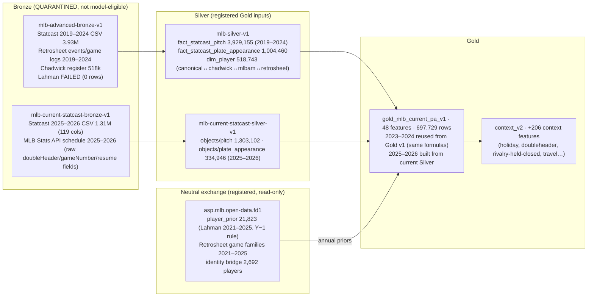

# MLB Remaining Feature Authority — Science Audit

Project `asp-mtlozhdx` — *MLB 2026 Current-Data Challenger v2 — Deliberate Development*
Audited HEAD `33cd85fa5074efeec3077036baea9c8b2ef86bdf` · main `924db29511f93909f9d785855bfa056775443690`
Isolated worktree `C:\Users\james\worktrees\asp-remaining-authority-audit` · branch `claude/mlb-remaining-feature-authority-audit` · 2026-09-03

Read-only audit. No production code, policy, Gold, artifact, or database row was modified. Final OOT (14,067 rows) was filtered out by `datasetRole` before any column was read; the `outcome` target column was never selected. No model was fit. Companion machine-readable record: `MLB_REMAINING_FEATURE_AUTHORITY_MATRIX.json`. Implementation prompt: `MLB_REMAINING_FEATURE_AUTHORITY_CODEX_PROMPT.md`.

Evidence labels: **OBSERVED** (read from code/manifests/data), **REPRODUCED** (computed in this audit on development-only, target-free data), **INFERRED**, **NOT TESTED**, **BLOCKED**.

---

## 0. Verdict in one paragraph

Every sufficient statistic the 13 remaining prior blockers demand **already exists inside the Current Gold build's own inputs and, in most cases, inside its own memory**. The six annual blockers (WHIP, ERA9, GS/G, AVG, OBP, SLG) are computed today in `server/sports_modeling/feature_view.py` from exact Lahman components (`AB, H, 2B, 3B, HR, BB, HBP, SF, SH, IPouts, ER, G, GS, BFP`) delivered by the registered FD1 `player_prior` family with a documented Y−1 point-in-time rule — the components are read, divided, and thrown away. The seven rolling blockers (whiff, contact, three usage shares, fastball velocity) are computed today in `server/sports_gold/features.py` from exact per-window `swing_count, whiff_count, contact_count, pitch_count, fastball_count, breaking_count, offspeed_count, fastball_velocity_count, fastball_velocity_sum` — likewise formed and discarded; only a velocity sum-of-squares is absent. Nothing needs to be invented, approximated, or newly acquired. What *should* be materialized is a scientific question, and the answer is: the components, not the familiar ratios. ERA9, OBP and contact-rate should be retired as redundant; rivalry should be removed from this challenger; the two semantic fields are deterministic recodes of structural non-events, not missing data.

## 1. Baseline (Phase 0)

| Item | OBSERVED |
|---|---|
| Primary checkout | `C:\Users\james\asp-model-studio`, branch `codex/mlb-governed-prior-engine-v1`, HEAD `33cd85f`; untracked: 10 `.pytest-*` scratch dirs, `ASP_MLB_Feature_Treatment_Specification.xlsx`, `docs/PHASE_7D3_CODEX_FINAL_SILVER_READINESS_REPORT.md` (all preserved, untouched) |
| Worktree | created from `33cd85f`; no other worktree registered on this repo; no source file in the primary modified in the preceding 6 h (only `.runtime` caches/logs) |
| Running processes | Model Studio uvicorn `127.0.0.1:8101` (PID 49524, started 21:41) and Vite `127.0.0.1:5274`; two OpenAI Codex sandbox processes (20:00) with no working-directory evidence — the primary was not touched by this audit; AISP uvicorn `:8010`, Vite `:5173`, PostgreSQL `:5432` belong to the other repository |
| Database | SQLite `.runtime\asp-model-studio\persistence\asp_model_studio.db` (46 MB, 114 tables), opened with `file:…?mode=ro` + `PRAGMA query_only=1` only |
| Staging roots | `C:\Users\james\asp-data-staging\{mlb-advanced-bronze-v1 (2.6 GB, QUARANTINED), mlb-current-statcast-bronze-v1 (867 MB), mlb-silver-v1 (6.3 GB), mlb-current-statcast-silver-v1 (133 MB), mlb-gold-v1 (1.6 GB), mlb-current-statcast-gold-v1 (42 MB), mlb-current-statcast-context-gold-v2}`; exchange `C:\Users\james\asp-model-exchange\{datasets/mlb-fd1, identity-bridges/mlb-fd1}` |
| Project | `asp-mtlozhdx`; Gold `gold-table:gold_mlb_current_pa_v1` 697,729 rows = 683,662 `DEVELOPMENT_SELECTION` (2023-03-30 … 2026-08-13) + 14,067 `FINAL_OOT` (never opened); prior authority `MLB_PLAYER_STATE_PRIOR_AUTHORITY_V1:sha256:a363331f…`; v3 combined spec DRAFT `stage3-feature-treatment-spec-22e4a89375cf43c58febe23f94f727bf`: 240 workbook features, 184 READY, 11 READY_GOVERNED_PRIOR_V1, 22 READY_WITH_EXPLICIT_FALLBACK, 23 BLOCKED (13 prior + 2 semantic + 8 interaction) + 14 rivalry backend fields held closed; registered feature sets for the project: 0; all six policies DRAFT; `fuzzyMatchesUsed: 0` |

Exact inventories verified from the persisted draft, not from prose:

* **13 prior** (`HOLD_NONEXECUTABLE_UNTIL_GOVERNED_PRIOR_AUTHORITY_EXISTS`): `pitcher_whip, pitcher_era9, pitcher_gs_per_g, batter_slg, batter_obp, batter_avg, pitcher_last250_avg_fastball_velocity, pitcher_last250_whiff_rate, pitcher_last250_offspeed_usage, pitcher_last250_fastball_usage, pitcher_last250_breaking_usage, batter_last100_whiff_rate, batter_last100_contact_rate`.
* **2 semantic** (`HOLD_NONEXECUTABLE_UNTIL_REGISTERED_SEMANTIC_VALIDATION`): `doubleheader_game_number, holiday_name`.
* **8 interaction** (`HOLD_UNTIL_PARENT_FIRST_FOLD_LOCAL_RECOMPUTATION_IS_REGISTERED`): `{batting,fielding}_{eastward_travel_x_early_start, long_travel_x_short_rest, prior_extra_innings_x_travel, road_trip_length_x_travel}` — out of scope here (another agent's lane).
* **14 rivalry** (`ABSENT_UNAPPROVED_RIVALRY_AUTHORITY`, `HELD_CLOSED_NO_TREATMENT_INFERRED`): `{batting,fielding}_{rivalry_pair, rivalry_game, home_rivalry_game, friday_night_home_rivalry, weekend_home_rivalry, home_x_rivalry, rivalry_mapping_missing}`.

## 2. Data architecture (Phase 1)

Object-level facts (all OBSERVED):

| Object | Grain / keys | Player key | Game key | Date field / knowledge time | Seasons | Rows | Rights | Used by Gold |
|---|---|---|---|---|---|---|---|---|
| FD1 `player_prior` | player × season × domain (BATTING/PITCHING/FIELDING), `official_date = Dec-31` | `canonical_player_id` (EXACT 100%), `lahman_player_id` | — | `eligible_from_season = season+1`; `official_date_semantics = ANNUAL_REGULAR_SEASON_PERIOD_END`; `same_season_predictor_eligible = False` | 2021–2025 | 21,823 | SABR Lahman CC BY-SA 3.0; `LOCAL_PRIVATE_MODEL_DEVELOPMENT` allowed | **Yes** (all annual features) |
| Legacy Silver `fact_statcast_pitch` | pitch; `canonicalPitchId`, `canonicalPaId`, `mlbamGamePk`, `atBatNumber`, `pitchNumber` | `pitcherCanonicalPlayerId`, `batterCanonicalPlayerId` | `canonicalGameId`/`mlbamGamePk` | `gameDate` only (no timestamp) | 2019–2024 | 3,929,155 | MLB Statcast `GOVERNED_LOCAL_RESEARCH_ONLY` | **Yes** (rolling features) |
| Current Silver `objects/pitch` | same schema + lineage columns | same | same | `gameDate`; PA carries `featureCutoffExclusive` | 2025–2026 | 1,303,102 | same | **Yes** |
| Legacy/current Silver PA | PA; `canonicalPaId` | same | same | `gameDate` | 2019–2026 | 1,004,460 + 334,946 | same | **Yes** |
| FD1 Retrosheet `player_game_pitching` / `player_game_batting` | player-game; `game_id`, `player_id` (Retrosheet ns) | `retrosheet_player_id` → `dim_player.retrosheetId` | `retrosheet_game_id`, `game_number`, `doubleheader_id` | `game_date`, `final_available_date`, `game_suspended`, `suspension_completion_date`; `strict_prior_eligible_after_game_final = True` | 2021–2025 | 104,610 / 356,498 | Retrosheet; `LOCAL_PRIVATE_MODEL_DEVELOPMENT`; actual-lineup/starter rows are `enhanced_research` (no strict pregame use) | No |
| FD1 `starter_usage` / `bullpen_usage` | pitcher appearance | same | same | same + `timing_risk_label` | 2021–2025 | 24,296 / 80,314 | `enhanced_research` | No |
| MLB Stats API raw `schedule.json` | game | — | `gamePk` | `officialDate`, `gameDate` (UTC), `doubleHeader`, `gameNumber`, `rescheduledFrom`, `resumeDate` | 2025–2026 | 4,499 obs | MLB terms; used for schedule only | Contextual Gold |
| Legacy Bronze (all) | files | — | — | — | 2019–2024 | — | QUARANTINED / NOT FEATURE-ELIGIBLE | No (Silver is the governed derivative) |

Absence from Current Gold was **not** absence upstream: every blocker's inputs are present one layer down, and for 12 of 13 they are already in the Gold builder's process memory.

## 3. Sufficient-statistic audit (Phase 2)

Registered definitions are those in `server/sports_modeling/feature_contract.py:123–138` and `server/sports_gold/features.py:203–223`. Legacy 2023–2024 rows were "copied unchanged from the verified governed Gen3 PA research view" — the same `feature_view.py` code path — so definitions are era-consistent (OBSERVED via `mlb-gold-v1/evidence/…/feature-specification.json`).

| Feature | Registered formula | Exact sufficient statistics | Where found | Complete? | Joinable via canonical identity? | Computable before target PA? | Same-game leakage? | Rolling state upstream? | Rights | Verdict |
|---|---|---|---|---|---|---|---|---|---|---|
| `pitcher_whip` | `3·(BB+H)/IPouts` (HBP excluded) | `BB, H, IPouts` | FD1 `player_prior.metrics_json` (PITCHING) — read in `_pitching_features` | yes (0 nulls) | yes (canonical→chadwick) | yes (Y−1 season) | no | annual state only | permitted | components exist |
| `pitcher_era9` | `27·ER/IPouts` | `ER, IPouts` | same | yes | yes | yes | no | annual | permitted | components exist |
| `pitcher_gs_per_g` | `GS/G` | `G, GS` | same | yes | yes | yes | no | annual | permitted | components exist |
| `batter_slg` | `(H+2B+2·3B+3·HR)/AB` | `AB, H, 2B, 3B, HR` | `metrics_json` (BATTING) — read in `_batting_features` | yes | yes | yes | no | annual | permitted | components exist |
| `batter_obp` | `(H+BB+HBP)/(AB+BB+HBP+SF)` | `H, BB, HBP, AB, SF` | same | yes | yes | yes | no | annual | permitted | components exist |
| `batter_avg` | `H/AB` | `H, AB` | same | yes | yes | yes | no | annual | permitted | components exist |
| `pitcher_last250_avg_fastball_velocity` | mean `releaseSpeed` over FA/FF/FC/SI pitches in last-250-BF window | `fastball_velocity_count`, `fastball_velocity_sum`, **`sumsq`** | `features.py` aggregates (count/sum computed; sumsq **not**) | count/sum yes; sumsq needs one aggregate | yes | yes (window strictly before target `gameDate`) | no | yes (in-memory) | permitted | 2 of 3 exist; 1 trivial addition |
| `pitcher_last250_whiff_rate` | `whiff_count/swing_count` | `swing_count, whiff_count` | `features.py` (computed, discarded) | yes | yes | yes | no | yes | permitted | exist |
| `pitcher_last250_{fastball,breaking,offspeed}_usage` | `family_count/pitch_count` (all pitches in denominator; unclassified retained) | `pitch_count, fastball_count, breaking_count, offspeed_count` | `features.py` (computed, discarded) | yes | yes | yes | no | yes | permitted | exist |
| `batter_last100_whiff_rate` | `whiff_count/swing_count` (last 100 PA) | `swing_count, whiff_count` | `features.py` batter payload | yes | yes | yes | no | yes | permitted | exist |
| `batter_last100_contact_rate` | `contact_count/swing_count` = `1 − whiff_rate` exactly (`SWING = WHIFF ∪ CONTACT`, contracts.py:169) | `swing_count, contact_count` | same | yes | yes | yes | no | yes | permitted | exist (algebraic complement) |

No approximate denominator is used anywhere: PA is never substituted for AB (SH and CI are the difference), BF is never substituted for swings or pitches, and the velocity denominator is the count of fastballs with a non-null `releaseSpeed` (null rate 0.4%, REPRODUCED on sample partitions).

Vocabularies (OBSERVED, frozen in `sports_gold/contracts.py`): whiff = `swinging_strike, swinging_strike_blocked, missed_bunt`; contact = `foul, foul_bunt, foul_tip, hit_into_play*`; fastball = `FA, FF, FC, SI`; breaking = `CU, KC, CS, SL, ST, SV`; offspeed = `CH, FS, FO, SC, KN, EP`; `PO`, `null` and any other type stay in `pitch_count` only. Development usage shares sum to 0.9962 on average (p05 0.9857) — the unclassified share is small and honest (REPRODUCED).

## 4. Point-in-time materialization contract (Phase 3)

Two authorities exist and must not be mixed silently:

* **Annual (season) authority** — FD1 `player_prior`: for target season Y, `_prior_lookup` selects the latest row with `season ≤ Y−1` and `eligible_from_season ≤ Y`; `same_season_predictor_eligible` is `False` on all 21,823 rows; `_metric` fails closed on missing/non-numeric/negative values (OBSERVED). A player's Y−2 state is used when no Y−1 row exists (latest eligible prior state, no decay — matches the engine's declared `NO_DECAY_ANNUAL_STATE_SOURCE_AGE_NOT_MATERIALIZED`).
* **Game-date authority** — Statcast Silver has no intra-game timestamp; `_prior_window_features` sorts each player's PA history by `(gameDate, mlbamGamePk, atBatNumber, canonicalPaId)` and takes `end = searchsorted(dates, target_date, side='left')`, so the window contains only PAs with `gameDate < target.gameDate`; **same-game and same-day earlier PAs are excluded** together with the target PA (OBSERVED, `features.py:1–8, 159–226`). Pitch classification/result/velocity enter only through those prior PAs' aggregates.

Materialization contract for Wave 1 (RECOMMENDED; identical semantics to the existing rates so equivalence is testable):

| Element | Contract |
|---|---|
| Source filters | Annual: `domain ∈ {BATTING, PITCHING}`, `identity_resolution_status = EXACT`, canonical in bridge dimension. Rolling: verified Silver child paths only (SHA-checked), `season ∈ 2019…2026`, `source_mode` per existing Gold. |
| Event ordering | Rolling: `(entity, gameDate, mlbamGamePk, atBatNumber, canonicalPaId)` mergesort (deterministic). |
| Same-game rule | Excluded (game-date authority). Documented as such; never relaxed to "earlier in same game". |
| Rolling window | last `250` BF (pitcher) / `100` PA (batter) of the entity's history strictly before target date; `sample = end − start`; insufficient flag when `sample < window`. |
| Prior-season logic | Y−1 latest eligible row; cross-season carry without decay; rookies → no annual row → `*_prior_missing = 1`, counts NULL (never 0). |
| Cumulative logic | prefix sums of per-PA count columns; window sums = `cum[end] − cum[start]`. |
| Player identity | `batterCanonicalPlayerId` / `pitcherCanonicalPlayerId`; annual via canonical→`chadwickKeyUuid` (`dim_player`, `MATCHED_EXACT`). |
| Role identity | none in Wave 1 (deferred, §7). |
| Season boundaries | rolling windows cross seasons (already); annual uses Y−1. |
| Postponed/resumed | Statcast rows carry the date the pitches occurred; a resumed game's later-date pitches sort on their actual date; annual unaffected. |
| Doubleheaders | both games share `gameDate`; both are excluded for any target on that date (existing behaviour; conservative and consistent). |
| Traded players | identity is player-level; team is irrelevant to these statistics. |
| Rookies / missing source events | annual NULL + missing indicator; rolling zero-count windows produce `swing_count = 0` → `*_whiff_missing = 1`; velocity `count = 0` → `velocity_missing = 1`. |
| Corrections/backfills | Silver objects are content-addressed; the builder recomputes from verified SHAs; the companion table's checksum changes iff inputs change. |
| Deterministic tie-breaking | `canonicalPaId` is the final sort key. |
| Idempotency | content-addressed object; rebuild yields the same SHA (existing Gold pattern). |
| Output grain | one row per `canonicalPaId` (697,729, matching Gold, incl. FINAL_OOT rows carried by key but **without** any outcome column). |
| Output checksum | manifest SHA-256 over canonical JSON + object SHA-256; recorded beside the Gold manifest SHA it was built from. |
| Integer validation | for every non-null existing rate, `rate × denominator` must reconstruct the numerator within `1e-6` (the engine's own rule). |

Leakage proofs required in Wave 1 tests: (a) shifting a target PA to an earlier date changes only windows of later PAs; (b) mutating the target PA's pitch results/outcome changes no count column of that PA; (c) appending future-season rows leaves earlier rows unchanged; (d) annual counts for season-Y rows equal `metrics_json` of the Y−1 (or latest eligible) row and never of season Y.

## 5. Coverage and quality (Phase 4) — development-only, target-free (REPRODUCED)

683,662 development rows, 2023-03-30 … 2026-08-13. FINAL_OOT filtered out by `datasetRole` before any read.

| Feature | Dev non-null | 2023 | 2024 | 2025 | 2026 | Notes |
|---|---|---|---|---|---|---|
| pitcher_whip / era9 / gs_per_g | 0.892 | 0.867 | 0.882 | 0.900 | 0.927 | annual pitcher prior present |
| batter_avg / obp / slg | 0.923 | 0.918 | 0.935 | 0.917 | 0.921 | annual batter prior present |
| pitcher_last250 velocity | 0.990 | 0.989 | 0.989 | 0.990 | 0.990 | velocity_missing 0.0104 |
| pitcher_last250 whiff / usage | 0.990 | 0.989 | 0.990 | 0.990 | 0.991 | whiff_missing 0.0100 |
| batter_last100 whiff / contact | 0.998 | 0.998 | 0.998 | 0.998 | 0.998 | whiff_missing 0.0019 |

* **Within-season decline of annual priors** (call-ups): 2025 WHIP coverage 0.967 (Mar) → 0.850 (Sep); batter AVG 0.973 → 0.860. 2023: 0.988 → 0.755 (Oct). This is legitimate cold start (`TRUE_COLD_START` 119,947 rows in the engine's own diagnostics), not source failure.
* **Cold-start / sparse**: `pitcher_prior_bf_count = 0` in 6,855 rows; `batter_prior_pa_count = 0` in 1,302; `pitcher_last250_insufficient` 0.168 (median BF among insufficient = 109); `batter_last100_insufficient` 0.054 (median PA = 46).
* **Annual denominators** (FD1, seasons 2022–2025): pitcher `IPouts` p10/50/90 = 8/108/401 with **348 of 3,462 rows < 3 IP** — the regime in which raw ERA9 reaches 108.0 and WHIP 12.0 in development; `GS/G` = 1,973 pure relievers, 662 pure starters, 827 mixed. Batter `AB = 0` in 3,204 of 5,876 Lahman rows (pitchers/pinch appearances) → rate NULL by `_safe_divide`.
* **Invalid domain**: 0 for all rates; velocity has 145 rows < 60 mph (FA-family eephus/position-player pitches; max 101.8) — flag, do not clip.
* **Identity failures**: 0 (bridge `exact_reference_rate = 1.0`; Gold `unseenPlayerCases` are true rookies, 1,317 batter / 7,007 pitcher rows).
* **Source-era**: means by season are flat across the 2024→2025 legacy/current seam — velocity 93.31/93.41/93.60/93.81 (league trend, +0.5 mph over 4 years), fastball usage 0.557/0.559/0.553/0.550, whiff 0.237/0.232/0.231/0.232, WHIP 1.27/1.34/1.31/1.31. **No source-era indicator would be introduced.** Backfill is adequate for all five development folds (Statcast 2019–2026 continuous; Lahman 2022–2025 covers every target season 2023–2026).

## 6. Scientific value and redundancy ranking (Phase 5)

Ranked by expected improvement to 8-class PA probability quality, discounted for redundancy with the 11 executable priors (`so/hr/hbp/bb per BFP`, `so/hr/bb+hbp per PA`, rolling K and BB rates) and for cost/risk. No model was fit; ranking uses definitions and baseball reasoning.

| Rank | Feature | Class | Why |
|---|---|---|---|
| 1 | `batter_last100_whiff_rate` | **MATERIALIZE_NOW** | Cleanest pre-outcome contact-skill signal; distinct denominator from K rate; 0.998 coverage; zero cost. |
| 2 | `pitcher_last250_whiff_rate` | **MATERIALIZE_NOW** | Stuff signal for STRIKEOUT class; partly independent of K rate; zero cost. |
| 3 | `batter_slg` → component vector | **REPLACE_WITH_COMPONENT_FEATURES** | The `{1B,2B,3B,HR,SO,BB+HBP,other}` count vector is the natural Dirichlet-Multinomial prior over the challenger's own outcome classes; SLG collapses it to one scalar. The engine already names this method. |
| 4 | `pitcher_last250_avg_fastball_velocity` | **MATERIALIZE_NOW** (+ sumsq) | Stable, low-redundancy stuff/fatigue measure; needs one added aggregate. |
| 5 | `pitcher_whip` → `H, BB, IPouts` | **REPLACE_WITH_COMPONENT_FEATURES** | The executable set has no hits-allowed rate; `H/IPouts` is the only ball-in-play suppression evidence. WHIP itself is redundant with `bb_per_bfp` + that component. Gamma-Poisson on components. |
| 6 | `pitcher_last250_{fastball,breaking,offspeed}_usage` | **MATERIALIZE_NOW** (as one Dirichlet family) | Approach/stuff proxy; main value is in interactions; materialize four counts once, never three independent proportions. |
| 7 | `batter_avg` → `H, AB` | **REPLACE_WITH_COMPONENT_FEATURES** | Hit-on-contact component is useful; AVG per se mixes K avoidance already covered. |
| 8 | `pitcher_gs_per_g` | **MATERIALIZE_NOW** (G, GS) | Low as a direct feature (stuff already measured), medium as the role-taxonomy input; zero marginal cost. |
| 9 | `batter_obp` | **RETIRE_AS_REDUNDANT_OR_WEAK** | Linear in components already materialized; keep as derived QA statistic only. |
| 10 | `batter_last100_contact_rate` | **RETIRE_AS_REDUNDANT_OR_WEAK** | Exact `1 − whiff_rate`; perfectly collinear. |
| 11 | `pitcher_era9` | **RETIRE_AS_REDUNDANT_OR_WEAK** | Sequencing/defense/scorer noise; dominated by components; do not materialize ER merely to clear the blocker. |

Answers to the mandate's specific questions: ERA9 and WHIP should **not** be recovered as ratios — their components (H, BB, IPouts) should; the K/BB/HR components are already executable and H is the missing one. AVG/OBP/SLG should **not** be retained beside component rates — the compositional vector supersedes all three. Whiff/contact deserve **higher** priority than any slash-line statistic. Pitch usage should be represented as a **Dirichlet-Multinomial composition** with an explicit "other" share. GS/G adds little beyond exposure as a feature but is the right seed for a role prior.

## 7. Role taxonomy feasibility (Phase 6)

**Pitchers — feasible without inventing information; DEFER to Wave 3.**

| Field | Source | Formula | Timestamp | Min history | Unknown | Cadence | Leakage test | Stability test |
|---|---|---|---|---|---|---|---|---|
| `pitcher_prior_role_y1` | FD1 `player_prior` PITCHING `G, GS` (Y−1) | `ESTABLISHED_STARTER` if `GS/G ≥ 0.8 ∧ G ≥ 10`; `ESTABLISHED_RELIEVER` if `GS/G ≤ 0.1 ∧ G ≥ 10`; `MIXED_OR_BULK` otherwise with `G ≥ 10`; `SPARSE` if `G < 10`; `TRUE_UNKNOWN` if no row | Dec-31 of Y−1 | 10 G | explicit state | annual | season-Y rows must equal Y−1 metrics | year-over-year transition matrix on 2022→2025 |
| `pitcher_rolling_role_lastN` | Statcast Silver: a pitcher who throws pitch 1 of `atBatNumber = 1` for his side in a game is that game's actual starter (derivable from `fact_statcast_pitch`/current pitch for 2019–2026, all prior games only) | start share over last 20 appearances strictly before target date; same thresholds | `gameDate` | 5 appearances | `TRUE_UNKNOWN` | per game-date | window strictly `< target gameDate` | share drift ≤ 0.1 between adjacent dates |
| `pitcher_opener_flag` | Statcast-derived starts + outs per start (outs per PA from `outsBeforePa` deltas / inning ends) | ≥ 60% of last 10 starts with ≤ 6 outs | `gameDate` | 5 starts | `TRUE_UNKNOWN` | per game-date | as above | as above |

Retrosheet `starter_usage`/`bullpen_usage` would be *simpler* but are `enhanced_research` (strict pregame use prohibited) and end in 2025 — a source-era break for the 2026 fold — so they are not the recommended source.

**Batters — only partially defensible; OMIT from V1.** Platoon side (`stand`) is already a registered pregame feature. A Y−1 position group from FD1 FIELDING `position` is defensible but low-value for PA outcomes. Lineup-role history exists only in Retrosheet `player_game_batting` (2021–2025, `enhanced_research` for the actual lineup, laggable for prior games) — no 2026 → unsuitable for the five-fold comparison. Current-game confirmed role must not be used (no governed pregame authority).

Conclusion: role priors → **DEFERRED** (pitcher taxonomy in Wave 3; batter taxonomy omitted).

## 8. Rivalry audit (Phase 7)

Nature: **a mixture** — a subjective, manually curated pair label (`MLB_RIVALRY_MAPPING_V1`, 12 proposed pairs: BOS–NYY, CHC–STL, LAD–SF, HOU–TEX, NYM–PHI, CHC–CWS, NYM–NYY, LAA–LAD, ATH–SF, MIA–TB, KC–STL, BAL–WSH; `PROPOSED_NOT_APPROVED`; "no pair was inferred from attendance, media coverage, team names, or model outcomes") multiplied by objective home/Friday/weekend flags. Point-in-time: the mapping carries no effective dates. Coverage: all 14 fields are NULL on 100% of development rows; the two `*_rivalry_mapping_missing` flags are the constant 1 (zero variance). Nine of the twelve pairs are same-division or same-metro, and the objective content — `division_game, same_division, same_league_game, interleague_game, repeat_opponent_within_7/14_days, series_rematch_indicator, home_x_friday_night, home_x_weekend` — is **already registered and READY**. Batting and fielding variants are symmetric duplicates. Narrative-bias susceptibility is high by construction.

**Recommendation: `REMOVE_FROM_CURRENT_CHALLENGER`** for all 14 (objective subcomponents are already present, so `REGISTER_OBJECTIVE_SUBCOMPONENTS_ONLY` is satisfied by existing fields). `BUILD_FUTURE_CURATED_AUTHORITY` remains available if James approves pairs with effective dates and franchise transitions; no value was created or activated here. Per-field records are in the matrix.

## 9. Semantic fields (Phase 8)

**`doubleheader_game_number`.** Both code paths encode "not a doubleheader" as `None` (`contextual_sources.py:306` `_strict_int(row.gameNumber) or None`; `:446` `game_number if doubleheader else None`). REPRODUCED: NULL rows (670,547) equal `is_doubleheader = 0` rows exactly; observed values are 1 (6,632) and 2 (6,483). Source evidence supports all four states: Retrosheet `gameNumber ∈ {0,1,2}` with `doubleheader_id` (2023–2025: 7,105/92/92 games) and raw MLB Stats API `doubleHeader ∈ {N, Y, S}` + `gameNumber ∈ {1,2}` for 2025–2026 (`S` = split doubleheader, e.g. gamePks 824132/824134 on 2026-04-04). Suspended games (13 in 2023–2025) keep their original identity and date with `final_available_date = completion date`; the raw API also carries `rescheduledFrom` / `resumeDate` / `resumedFrom`, which the curated authority drops. **Recommended semantics:** `0 = not a doubleheader (source proves N / gameNumber 0)`, `1`, `2`, `NULL = schedule source absent` (currently zero rows); optional `doubleheader_type ∈ {NONE, TRADITIONAL, SPLIT}`; a resumed suspended game keeps its original `game_number`; a same-day resumption plus a scheduled game is not a doubleheader unless the source flags one. No imputation; median is prohibited.

**`holiday_name`.** Calendar `US_CA_ON_BASEBALL_CALENDAR_V1` keyed on the **venue's** local date of scheduled first pitch: US venues → `MEMORIAL_DAY, JUNETEENTH (observed), INDEPENDENCE_DAY (observed), LABOR_DAY`; Ontario (Toronto) → `VICTORIA_DAY, CANADA_DAY (observed), CIVIC_HOLIDAY, LABOUR_DAY`. REPRODUCED: NULL rows (669,000) equal `is_holiday = 0` rows exactly; `holiday_region` is populated for 100% of development rows (so calendar coverage is complete, not "source unavailable"); observed names: INDEPENDENCE_DAY 4,315, JUNETEENTH 4,022, MEMORIAL_DAY 3,335, LABOR_DAY 2,693, CANADA_DAY 221, VICTORIA_DAY 76. No two entries share a date in the current lists. **Recommended semantics:** `NONE` when `holiday_region` is resolved and `is_holiday = 0`; `UNKNOWN_HOLIDAY` only when venue/region is unresolved; venue jurisdiction (crowd/scheduling effect) rather than team-home jurisdiction; deterministic precedence = calendar list order if a future calendar introduces an overlap; keep `holiday_calendar_version` in lineage. No imputation; mode is prohibited.

Both fields are therefore **deterministic recodes of structural non-events**, and their `SOURCE_UNAVAILABLE` labelling in the accepted workbook is a mis-classification. Registering the calendar/semantic validation authority is documentation-and-recode work, not data acquisition. It is outside Wave 1 by design (different blocker family).

## 10. Roadmap (Phase 9)

**Wave 1 — exact sufficient statistics already read or computed (RECOMMENDED; the Codex prompt covers exactly this).**
Source: FD1 `player_prior` metrics + `features.py` window aggregates. New fields (companion table `gold_mlb_current_pa_sufficient_stats_v1`, keyed by `canonicalPaId`, never a target column): batting `AB, H, 2B, 3B, HR, BB, HBP, SF, SH, SO`; pitching `IPouts, H, BB, HBP, BFP, G, GS`; rolling pitcher `pitch_count, swing_count, whiff_count, fastball_count, breaking_count, offspeed_count, fastball_velocity_count, fastball_velocity_sum, fastball_velocity_sumsq`; rolling batter `swing_count, whiff_count`. Pipeline stage: `build_current_gold` (a companion publication beside the frozen 48-feature Gold; the Gold manifest, its SHA and the 48-feature contract are unchanged). Manifest impact: one new content-addressed publication + registration row; no migration. Storage: 697,729 × 28 integer columns ≈ 15–25 MB zstd. Runtime: negligible (aggregates already computed; one added sum-of-squares). Tests: equivalence (every existing rate reconstructs from the counts within 1e-6), the four leakage proofs in §4, OOT untouched, no target column, deterministic checksum, Gold manifest byte-identical. Blockers affected: 12 of 13 become bindable (all but `pitcher_era9`, retired by design); of those, `batter_obp` and `batter_last100_contact_rate` are retired even though bindable. Rationale: smallest change that unlocks the highest-value signal (whiff, composition, velocity, hit component) with zero new sources.

**Wave 2 — engine bindings for the families.** Dirichlet-Multinomial over batting components and pitch families; Gamma-Poisson for `H/IPouts`, `BB/IPouts`; Normal-Normal for velocity with within-window variance. Pure `stage3_player_prior_authority.py` work; no Gold change.

**Wave 3 — pitcher role taxonomy (optional).** Statcast-derived actual starts + Y−1 `G/GS`; opener detection from outs per start. Adds a role layer to the hierarchy that V1 correctly left empty.

**Wave 4 — deferred or retired.** `ER`/`R` (only if a run-level construct is ever wanted), Retrosheet lineup roles (no 2026), rivalry authority (removed), semantic recodes (separate calendar-validation registration).

## 11. Verification record

* Exact 13-feature and 14-rivalry inventories: verified from the persisted v3 draft (`fuzzyMatchesUsed: 0`); names in this report are copied verbatim.
* Read-only DB use: `sqlite3` URI `mode=ro` + `PRAGMA query_only=1`; zero writes.
* Final-OOT access: 0 rows (filtered by `datasetRole` before any column read).
* Target access: 0 (`outcome` never selected).
* Policy creation/adoption, feature-set registration, model fit, artifact/Gold mutation: none.
* Existing tests in the isolated worktree (temp roots only): `sports_stage3_player_prior_authority_test.py`, `current_statcast_pa_test.py`, `current_statcast_contextual_features_test.py`, `current_statcast_contextual_sources_test.py` — **35 passed** in 4.74 s.
* Temporary analysis scripts lived only in the Claude scratchpad outside Git.

## 12. Decisions for James

1. Approve Wave 1 as scoped (components, not ratios; ERA9/OBP/contact retired).
2. Confirm removal of the 14 rivalry fields from this challenger (or approve pairs with effective dates for a future curated authority).
3. Confirm the doubleheader (`0/1/2/NULL`) and holiday (`NONE`/`UNKNOWN_HOLIDAY`) semantics for the separate semantic-validation registration.
4. Decide whether the pitcher role taxonomy (Wave 3) is wanted for this challenger or for V3.
