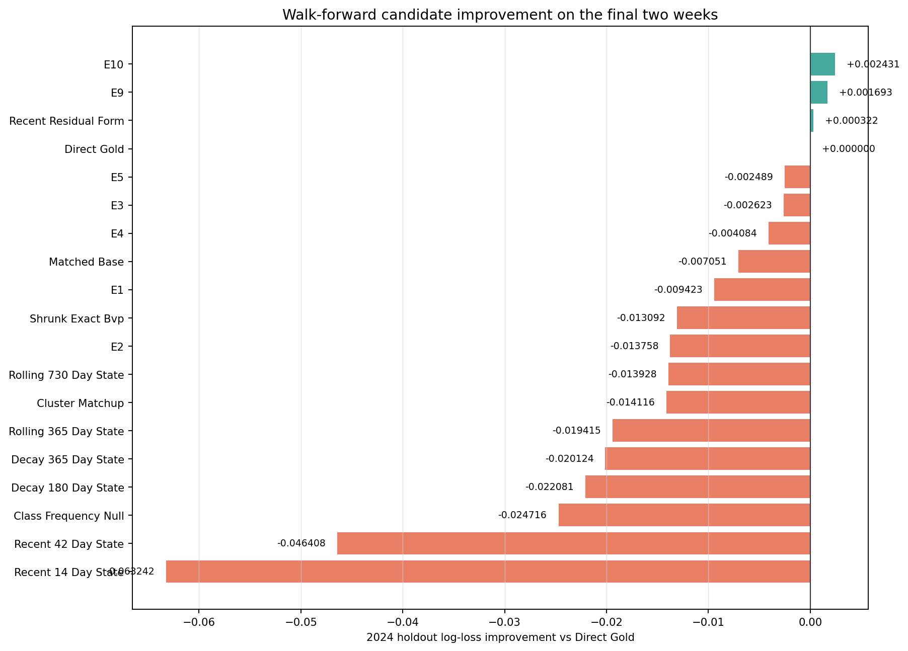
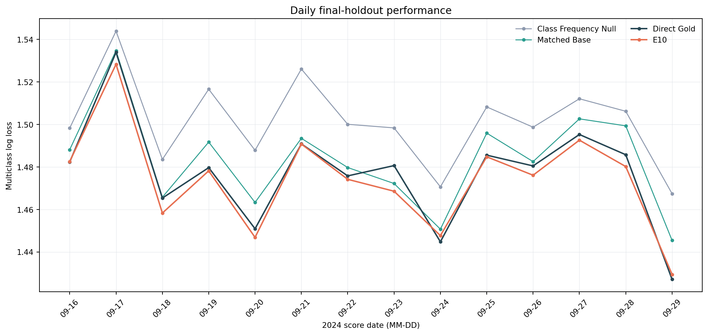
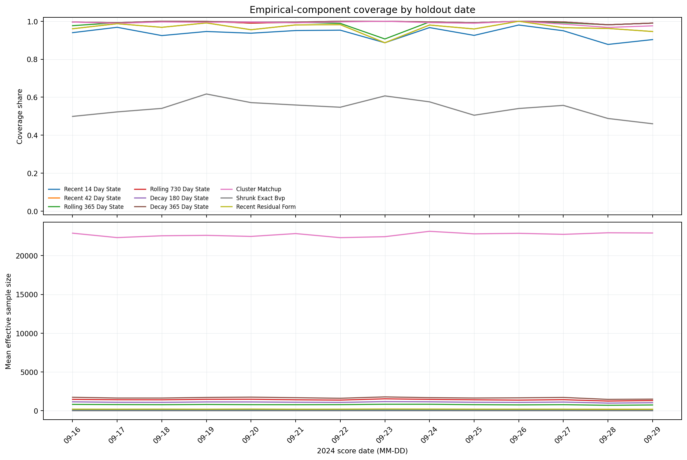
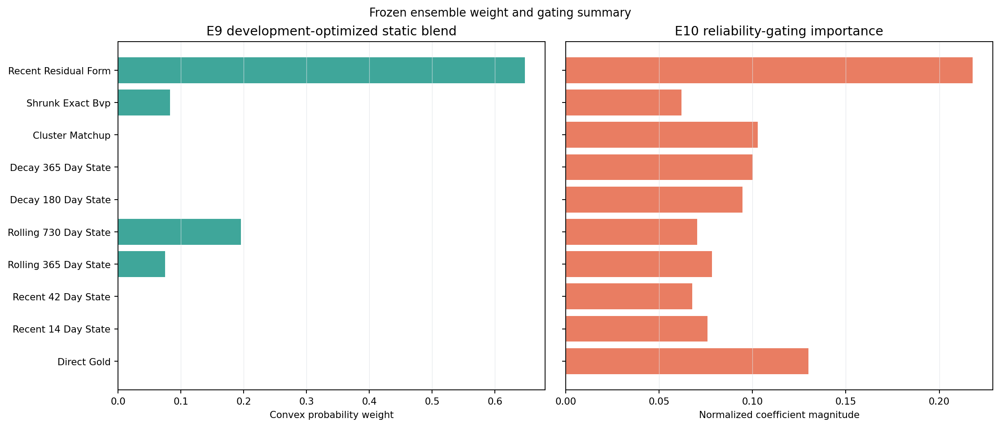

# Phase 7B5 Recent-Data Walk-Forward Study

## Terminal result

`F. USE_RELIABILITY_GATED_ENSEMBLE`

The OOF-selected E10 reliability-gated ensemble improved final-holdout log loss from `1.4768990664533868` for Direct Gold to `1.4744684728660358`, an improvement of `0.002430593587350982`. E10 also improved summed Brier from `0.7061603288555925` to `0.70493579218646` and beat Direct Gold on 11 of the 14 holdout dates.

This is a research-only recommendation. No model was promoted.

## Frozen populations

- Gold V1 logical content: `56162deb2473e173685012775fcedecca7f88ba59dffacbb04e49c918371a3f0`
- Final holdout: `2024-09-16` through `2024-09-29`
- Holdout: 14 active dates, 13,766 plate appearances, 183 games
- Final pre-holdout training population: 703,047 rows
- Combined five-fold OOF population: 524,525 rows
- Seasons opened: 2021, 2022, 2023, 2024
- 2025/2026 opened: no

The holdout identity and boundaries were persisted in `request.json` before fitting. All validation blocks were date-atomic and expanding; no random folds were used.

| Fold | Training cutoff | Training rows | Validation period | Validation rows |
|---|---:|---:|---|---:|
| FOLD_1 | 2021-10-03 | 178,522 | 2022-04-07–2022-07-25 | 105,063 |
| FOLD_2 | 2022-07-25 | 283,585 | 2022-07-26–2023-05-03 | 105,289 |
| FOLD_3 | 2023-05-03 | 388,874 | 2023-05-04–2023-08-19 | 104,339 |
| FOLD_4 | 2023-08-19 | 493,213 | 2023-08-20–2024-05-29 | 105,172 |
| FOLD_5 | 2024-05-29 | 598,385 | 2024-05-30–2024-09-15 | 104,662 |

For date `D`, state used only rows with `game_date < D`. Earlier dates in a validation block updated later dates only after the earlier date closed. E9 weights and E10 parameters were fit solely on the combined OOF predictions and fingerprinted unchanged before and after holdout scoring.

## Final-holdout leaderboard highlights

| Method | Log loss | Summed Brier | ECE | Accuracy | Macro-F1 | Improvement vs Direct |
|---|---:|---:|---:|---:|---:|---:|
| E10 reliability-gated | 1.474468473 | 0.704935792 | 0.009046518 | 0.443992445 | 0.090255015 | +0.002430594 |
| E9 optimized convex | 1.475205932 | 0.705183825 | 0.008566062 | 0.445808514 | 0.089996276 | +0.001693134 |
| Recent residual form | 1.476576583 | 0.705972266 | 0.007269860 | 0.445227372 | 0.093389195 | +0.000322484 |
| Direct Gold | 1.476899066 | 0.706160329 | 0.007556638 | 0.445517943 | 0.091976947 | 0.000000000 |
| Matched Base | 1.483950350 | 0.709455509 | 0.009606868 | 0.443556589 | 0.084172704 | -0.007051284 |
| Class-frequency null | 1.501615447 | 0.715699061 | 0.005289138 | 0.442902804 | 0.076738156 | -0.024716381 |

E10's log-loss improvement was `0.027146974326857087` versus null and `0.009481877232386138` versus matched Base. Its ECE, accuracy, and macro-F1 did not improve over Direct Gold; the recommendation is specifically supported by the predeclared OOF log-loss selection and positive holdout log-loss/Brier result.

The complete 19-method aggregate leaderboard is in [candidate-performance.csv](phase7b5_recent_data_walk_forward/tables/candidate-performance.csv). Daily results for every comparison candidate are in [daily-performance.csv](phase7b5_recent_data_walk_forward/tables/daily-performance.csv).

## Standalone coverage and effective sample size

| Component | Coverage | Mean effective sample size |
|---|---:|---:|
| Direct Gold | 1.000000 | n/a |
| Recent 14-day state | 0.938108 | 71.153 |
| Recent 42-day state | 0.969781 | 205.246 |
| Rolling 365-day state | 0.989830 | 784.059 |
| Rolling 730-day state | 0.994407 | 1,410.212 |
| Decay 180-day state | 0.994915 | 1,098.979 |
| Decay 365-day state | 0.994915 | 1,652.524 |
| Cluster matchup | 0.989757 | 22,707.357 |
| Shrunk exact BvP | 0.538791 | 4.840 |
| Recent residual form | 0.969781 | 205.246 |

Unavailable empirical histories used the declared fallback probabilities; no eligible holdout row was omitted. Every requested component and ensemble completed successfully.

## Frozen ensemble summaries

E9 assigned nonzero probability weights only to recent residual form (`0.6477071522`), rolling 730-day state (`0.1953261829`), shrunk exact BvP (`0.0823522839`), and rolling 365-day state (`0.0746143810`).

E10's largest normalized coefficient-importance groups were recent residual form (`0.2177493707`), Direct Gold (`0.1300229699`), cluster matchup (`0.1028651066`), decay 365-day state (`0.1001441599`), and decay 180-day state (`0.0945575082`). These are coefficient-magnitude diagnostics, not probability weights.

Full inclusion and parameter summaries are in [component-inclusion.csv](phase7b5_recent_data_walk_forward/tables/component-inclusion.csv) and [ensemble-weights-gating.csv](phase7b5_recent_data_walk_forward/tables/ensemble-weights-gating.csv).

## Review charts

## Governance and provenance

- Bronze rebuilt: no
- Silver rebuilt: no
- Gold rebuilt or altered: no
- Current Silver PA authority reverified before and after scoring: yes
- Gold manifest SHA before/after: `5e962e86aabe4450b05e13552814ce46355ab3e92a08641d890b1e47adf8629b`
- Model promotion: no
- Candidate failures or silent omissions: none
- External artifact root: `C:\Users\james\asp-data-staging\mlb-gold-v1\recent-data-walk-forward-studies\sha256\558d836e0080f7375a9884c1d370b164b0b109d64a23f50806d657b6c7b8a647`

Silver supplied the independently verified canonical identity/date/source authority already bound into Gold. Outcome history used the exact Gold target rows; no unmatched Silver projection or new 2019–2020 target crosswalk was introduced.

The complete persisted request, result, fold evidence, and artifact manifest are under [phase7b5_recent_data_walk_forward/evidence](phase7b5_recent_data_walk_forward/evidence/).

RECENT_DATA_WALK_FORWARD_STUDY_COMPLETE
