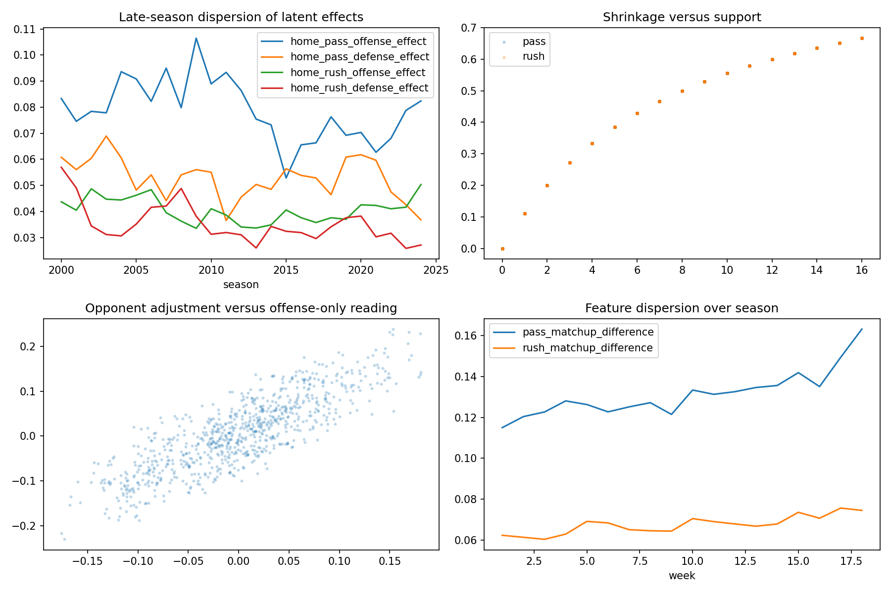
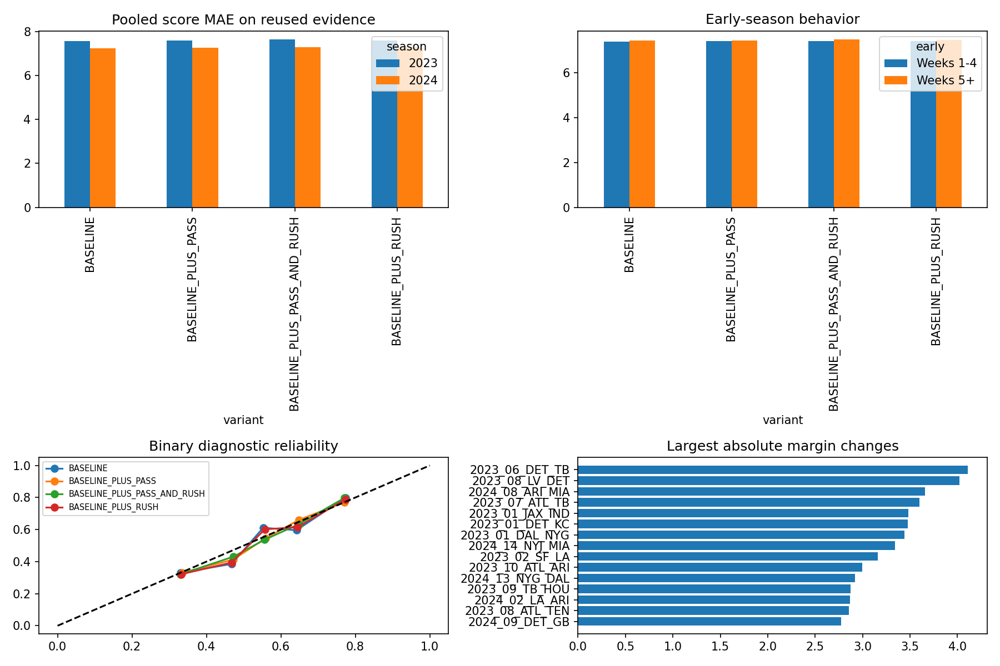

# Schedule adjustment did not improve NFL M1 score forecasts

## Executive summary

The declared schedule-adjusted pass/run challenger is **`NO_INCREMENTAL_VALUE`**. On 544 previously inspected regular-season games from 2023–2024, every feature variant worsened pooled score MAE relative to the chronological 197-feature NFL M1 baseline. Pass effects added 0.0124 points, rush effects added 0.0318, and the combined block added 0.0489. Rush was the clearest negative result: its calendar-week clustered 95% interval was `[+0.00005, +0.06345]` points.

The small pass-only improvements in binary log loss (-0.00146) and Brier (-0.00047) were imprecise and accompanied worse score and total MAE. The combined block lowered winner accuracy in both seasons. No variant met the frozen gate, so none should proceed to prospective capture or production.

## What was tested

The experiment fits separate latent pass-offense, pass-defense, rush-offense, and rush-defense effects. Each game-level EPA observation is modeled with offensive team, opponent defense, season environment, and offense venue. Ridge shrinkage and explicit prior-season decay address schedule imbalance and early-season support.

Development selection was frozen before 2023–2024 score outcomes were loaded. Four configurations were allowed: ridge alpha 10 or 50 crossed with season decay 0.50 or 0.75. Alpha 10 / decay 0.50 had the lowest mean Development unit RMSE (0.25522; pass 0.30283, rush 0.20760) over 1,598 team-game observations from 799 games in 2020–2022.

Origins are season-week atomic. Every game in the target week is excluded, even an earlier Thursday game. Source dates must precede the earliest game in the origin. Missing EPA remains missing. A team with no current-season history receives a league-centered ridge prior plus explicit zero support and a cold-start status.

## Baseline reconciliation

The research clone uses the same ordered 197 `GAME_FEATURES`, `IndependentHomeAwayScoreModel`, fixed `XGBOOST_SCORE_CONFIG`, and seed 731001 as NFL M1. It fits a fresh model at each assessment season using strictly earlier seasons.

The 2022 reproduction exactly matches the retained readiness result: 271 games, pooled score MAE 7.05118, margin MAE 8.90497, total MAE 10.68796, binary log loss 0.63513, Brier 0.22197, AUC 0.68504, and winner accuracy 0.64684. Two tied finals are excluded from the binary probability metrics.

This research clone is distinct from the retained all-history artifact, which was trained on 7,276 games from 1999–2025 through 2026-02-08, and from operational packages, which bind point predictions to a separate 10,000-draw paired-residual, three-way distribution. The all-history artifact was not used as a historical predictor here. The research probability is a binary diagnostic proxy and is not an operational NFL tie/away/home probability.

## Reused 2023–2024 results

All values are lower-is-better except accuracy. These seasons were already inspected and are reused diagnostic evidence.

| Season | Variant | Home MAE | Away MAE | Score MAE | Margin MAE | Total MAE | Accuracy | Log loss | Brier |
|---|---|---:|---:|---:|---:|---:|---:|---:|---:|
| 2023 | Baseline | 7.5480 | 7.5949 | 7.5714 | 10.3964 | 10.6005 | 0.6324 | 0.6560 | 0.2319 |
| 2023 | + Pass | 7.5728 | 7.5896 | 7.5812 | 10.3997 | 10.6438 | 0.6287 | 0.6545 | 0.2316 |
| 2023 | + Rush | 7.5570 | 7.6228 | 7.5899 | 10.4156 | 10.5690 | 0.6066 | 0.6543 | 0.2310 |
| 2023 | + Pass + Rush | 7.6523 | 7.6125 | 7.6324 | 10.5054 | 10.6268 | 0.5882 | 0.6600 | 0.2338 |
| 2024 | Baseline | 7.6102 | 6.8596 | 7.2349 | 10.0287 | 9.9992 | 0.6912 | 0.6180 | 0.2141 |
| 2024 | + Pass | 7.6213 | 6.8783 | 7.2498 | 10.0211 | 10.0674 | 0.6801 | 0.6166 | 0.2135 |
| 2024 | + Rush | 7.6251 | 6.9348 | 7.2799 | 10.1082 | 10.0205 | 0.6765 | 0.6186 | 0.2145 |
| 2024 | + Pass + Rush | 7.6183 | 6.9250 | 7.2717 | 10.0664 | 10.0679 | 0.6691 | 0.6171 | 0.2138 |

### Candidate minus baseline, pooled over 544 games

Positive error-score deltas are worse.

| Variant | Score MAE Δ | Week-clustered 95% | Margin MAE Δ | Total MAE Δ | Log loss Δ | Brier Δ |
|---|---:|---:|---:|---:|---:|---:|
| + Pass | +0.01235 | [-0.03001, +0.05812] | -0.00212 | +0.05582 | -0.00146 | -0.00047 |
| + Rush | +0.03175 | [+0.00005, +0.06345] | +0.04940 | -0.00507 | -0.00052 | -0.00023 |
| + Pass + Rush | +0.04886 | [-0.00490, +0.10113] | +0.07335 | +0.04753 | +0.00154 | +0.00079 |

Calendar weeks, rather than model rows, are the bootstrap units. The 5,000/10,000 simulation-draw concept does not apply to this point-model assessment.

## Calibration and segments

Baseline calibration differed materially by season: intercept/slope were 0.0427/0.7830 in 2023 and -0.1295/1.2524 in 2024. The feature blocks did not stabilize that movement. Pass-only calibration slopes were 0.8128 and 1.2635; combined slopes were 0.7483 and 1.2410.

No post-result segment supports routing. Pass-only score MAE improved in Weeks 10+ (-0.0332; 270 games) and short-rest games (-0.0322; 38), but worsened in Weeks 5–9 (+0.0889), high projected totals (+0.1086), and interconference games (+0.0420). Rush worsened every declared score-MAE segment. Combined effects also worsened every segment, including +0.1327 in interconference games and +0.1279 in Weeks 5–9.

For baseline-designated favorite sides, pass increased score MAE from 7.3983 to 7.4551 while reducing underdog-side MAE from 7.4080 to 7.3760. This redistribution does not establish a useful model improvement.

## Data quality and limitations

- The feature sidecar covers 6,447 regular-season target games from 2000–2024 and has zero missing predictor cells.
- The source was the governed `fact_nfl_team_game` object, filtered to `season <= 2024` before conversion to pandas. No 2025 assessment or 2026 row/outcome entered the study.
- Governing canonical identities map legacy OAK/SD/STL/LA records to LV/LAC/LAR; the sidecar has no legacy alias target.
- Historical finalized nflverse-derived revisions certify values and lineage, but not original publication vintages.
- Unit EPA is a game-level mean. Pass/run play counts were unavailable in the admitted team-game object, so the transparent unit estimator is unweighted by unit play count.
- The feature blocks add information close to existing M1 rolling offensive and defensive EPA features. The result may reflect redundancy as much as poor latent-effect estimation.
- Segment results are diagnostic only. They cannot create a production routing rule.

## Decision

Do not promote, deploy, or schedule this challenger. The exact next dependency for revisiting schedule adjustment is new evidence that changes the representation rather than another tuning pass—most plausibly governed unit play counts or a genuinely different opponent-adjusted quantity—followed by a newly frozen design. The current result does not justify prospective shadow capture.

NFL production, AISP, schedules, providers, and the prior MLB player-prop capture deployment remained unchanged.
